# HeadRush MX5 NAM A2 Pro + Drop Starcz (v9.1)

[English](README.md) | [Português](README.pt-BR.md) | **Español**

Firmware personalizado para el **HeadRush MX5 (2.7)** que ejecuta modelos **NAM (Neural Amp Modeler)**, incluidos los modelos **A2** en tamaño completo, y trae pedales rehechos para bajo: el **Drop Starcz** y el **IR largo**.

**Hecho por un bajista, pensado para tocar en vivo.** La v9.1 salió de ensayos y shows: corregimos todo lo que molestaba en el escenario en la versión anterior. Cambiar el modelo NAM dejaba casi un segundo de silencio, el drop de fábrica retrasaba el ataque y quitaba peso, el IR cortaba la cola y el gate mataba el sonido demasiado pronto.

Es un trabajo derivado de [lolgab/headrush-nam-mod](https://github.com/lolgab/headrush-nam-mod) (v0.1.6), con los motores A2 de [tone-3000/embedded](https://github.com/tone-3000/embedded) portados a ARMv7 NEON y la [MX5 Bridge](#fuentes-y-créditos) para acceder al equipo desde el PC. Proyecto desarrollado y compilado con **Claude Fable 5.2** (Anthropic).

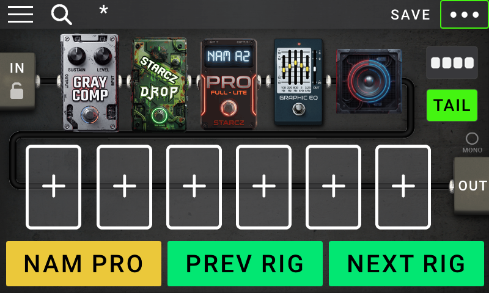

*Pantalla de la MX5 con la v9.1: compresor, Drop Starcz, NAM A2 Pro, EQ e IR.*

> 💚 **Apoye el proyecto.** Cada versión lleva muchas horas de pruebas y cuesta caro en uso de IA. Si el mod le ayudó, vea las [billeteras para donar al final de la página](#apoye-el-proyecto).

> **Aviso.** Firmware no oficial, sin relación con HeadRush/inMusic. Grabar firmware modificado es bajo su propio riesgo y puede anular la garantía; los autores no se responsabilizan por daños. El repositorio y el instalador **no** contienen el firmware ni el actualizador de HeadRush: el instalador parte del actualizador oficial, descargado del sitio de inMusic en el momento. Recuperación de la MX5: footswitches 1+2 al encender y grabar el actualizador oficial 2.7 (2+3 borra los rigs).

## Novedades de la v9.1, en palabras simples

### 1. Cambio de modelo NAM sin hueco en el sonido

En la v8, al girar el botón MODEL NAM el sonido **desaparecía casi un segundo** mientras se armaba el modelo nuevo. En vivo, eso es un hueco en medio de la canción.

En la v9.1 los modelos quedan **listos en la memoria antes de que los necesite** (la MX5 tiene 1 GB de RAM de sobra). El cambio pasó a ser un cruce rápido de volumen de **~18 ms**, sin silencio. En 321 cambios medidos en el equipo, ninguno quedó en silencio.

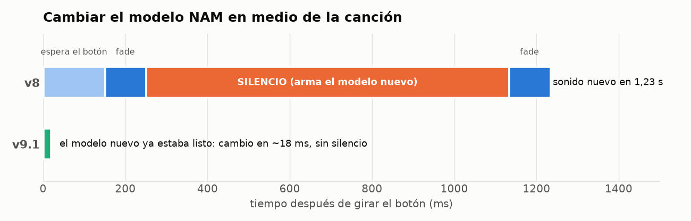

### 2. Drop Starcz: un drop nuevo para bajo

El Drop Tune de fábrica retrasa el ataque de la nota ~12 ms y deja el sonido "blando", malo para djent y metal industrial. El **Drop Starcz** es un algoritmo nuevo, hecho para bajo:

- El ataque sale en **~2,5 ms** (la púa sigue seca).
- Afinación correcta (±1 cent) y agudos preservados.
- Pesa poco en el procesador (~20 µs por bloque).

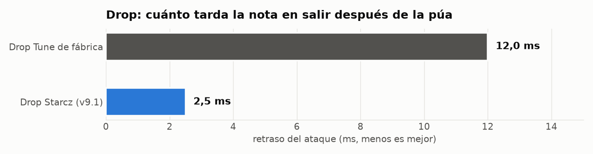

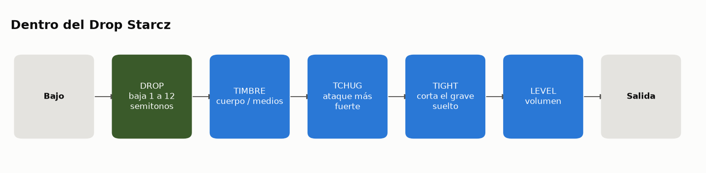

| Botón | Qué hace |
|---|---|
| **DROP** | Cuánto baja: Down 1 a Down 12 (12 = una octava). |
| **TIMBRE** | 0% = crudo, 50% = neutro, 100% = más medios y cuerpo. |
| **LEVEL** | Volumen, de -12 a +12 dB (centro = 0 dB). |
| **TCHUG** | Realza la púa apagada (palm mute): ataque más fuerte y cola más seca. 0% = apagado. |
| **TIGHT** | Corta el grave suelto (subgrave) para que el riff quede firme. 0% = apagado. |

Trae presets listos: **+ DROP 1 a 7**, **+ OITAVA ABAIXO** (octava abajo), **DJENT -2/-4/-5**, **INDUSTRIAL -4**, **TCHUG MAX -4**, **SUB PESADO -4** y **PALHETA SECA -4** (púa seca).

El Drop Starcz ocupa el lugar del pedal **Panner** (poco usado en bajo). El **Drop Tune de fábrica sigue ahí**, igual, en Modulation: puede comparar los dos en el mismo rig.

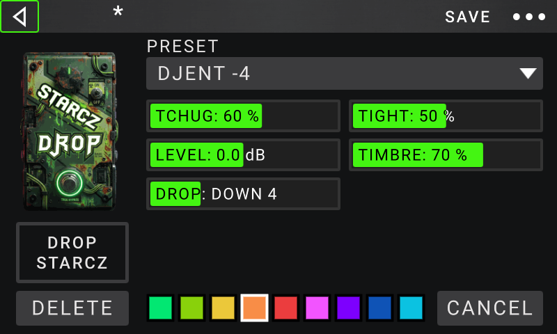 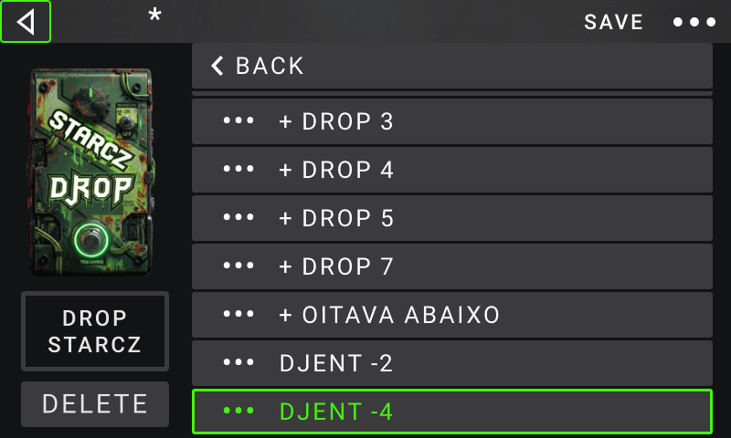

### 3. IR largo: el IR suena completo

De fábrica, la MX5 usa solo el comienzo del archivo de IR (2048 muestras = 43 ms) y descarta el resto. Gabinetes con sala, IR de micrófono lejano y reverbs pierden la cola.

En la v9.1 **suena el archivo entero (hasta 12 s)**: el comienzo sigue en el bloque de fábrica y la cola se calcula aparte, en el núcleo 3 del procesador, sin cargar el audio (un reverb de 4,5 s usa ~4% de ese núcleo).

- En un gabinete de 1 s, la diferencia con el IR completo bajó de -33 dB a -55 dB.
- Los archivos de **44,1 kHz** también funcionan.
- El **volumen se nivela solo**: IR que venían +7 a +14 dB más altos (y saturaban) entran a un nivel medio, y usted ajusta con el botón.

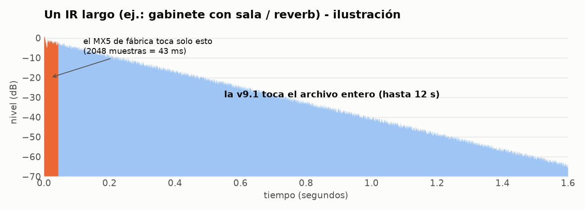

### 4. El procesador usado por completo

La MX5 tiene un procesador de **4 núcleos**, pero de fábrica casi todo corre en uno y dos quedan parados. Desde la v8 el NAM tiene un núcleo propio; en la v9.1 el último núcleo libre prepara los modelos y calcula la cola del IR.

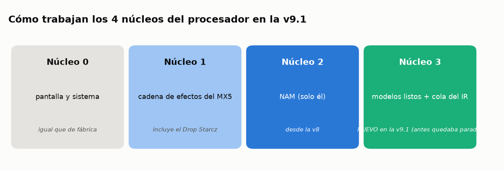

### 5. Mejores valores por defecto para el escenario

- **NAM en FULL por defecto** (suena idéntico al NAM oficial). Los rigs guardados en LITE pasan a FULL.
- **Gate del NAM en -40 dB** por defecto: en la v8 cortaba el final de la nota demasiado pronto.
- **Accesos en el Model Selector**: NAM A2 y DROP STARCZ al principio, antes de Amp.

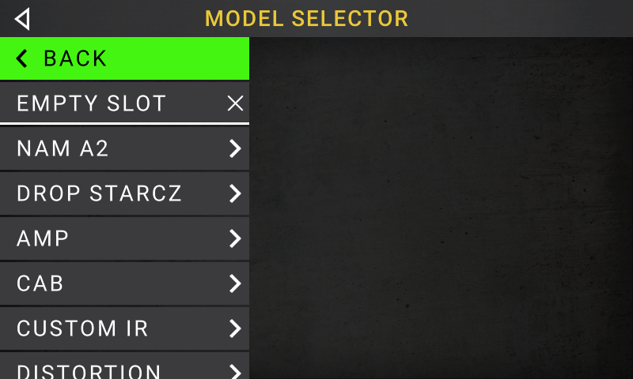 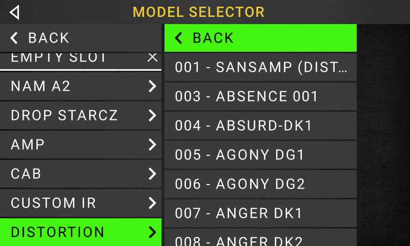

## NAM A2 Pro (en el lugar del 8-Bit Crush)

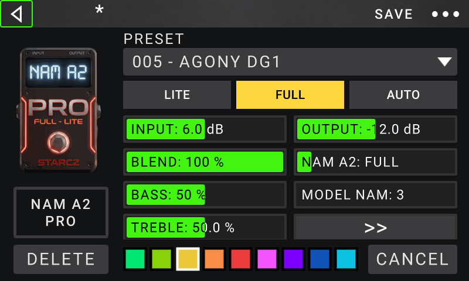 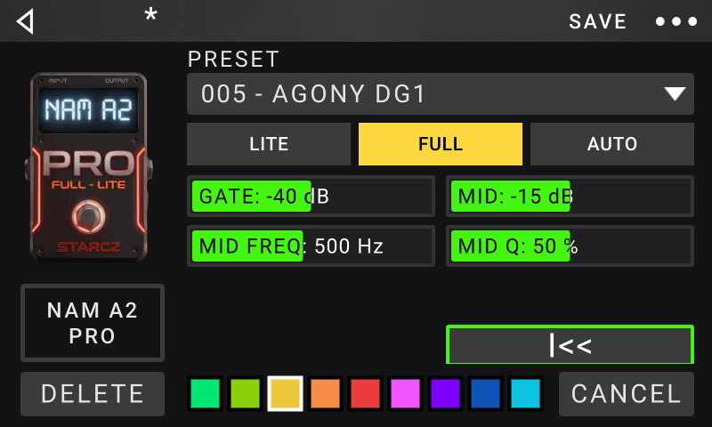

| En la pantalla | Qué hace |
|---|---|
| **LITE / FULL / AUTO** | Tamaño del modelo. **FULL** suena idéntico al NAM oficial; **LITE** es más liviano para el procesador; **AUTO** elige solo. |
| **MODEL NAM** | Elige el modelo. **1 clic del botón = 1 modelo.** También se puede elegir por nombre en la lista de presets. |
| **INPUT / OUTPUT** | Ganancia que entra al modelo y volumen que sale. |
| **BLEND** | Mezcla del bajo limpio con el NAM. 100% = solo NAM. Por debajo, el grave limpio queda firme debajo de la distorsión. |
| **BASS / TREBLE / MID / MID FREQ / MID Q** | Ecualizador después del NAM. MID Q en 0% = EQ OFF. |
| **GATE** | Corta el ruido cuando no está tocando (OFF en el mínimo). |

**Cómo funciona el Sync:** copie los `.nam` a la carpeta `NAM` de la MX5 y toque **Sync**. La MX5 numera sola los archivos nuevos (`NNN - nombre`) y, de 10 a 60 segundos después, la **aplicación se reinicia sola una vez** para crear los presets y corregir los rigs guardados. No es un bloqueo: no apague.

## Cómo instalar (paso a paso)

1. Vaya a **[Releases](../../releases/latest)** y descargue **`MX5_NAM_A2_v9.1.zip`**. Extráigalo.
2. Doble clic en **`Instalar_MX5_NAM_A2_v9.1.exe`** (deje la carpeta `_instalador_arquivos` al lado). Elija el idioma y el arte (1 = Starcz, 2 = de fábrica). Descarga el actualizador oficial de HeadRush 2.7 y arma el firmware (unos 2 minutos). Si Windows o el antivirus avisa, haga clic en **Más información > Ejecutar de todas formas** (no hay certificado de firma pagado; el código está aquí).
3. Conecte la MX5 a la corriente y al USB. En la MX5: **Global Settings > … > Firmware Update**.
4. Abra **`FirmwareUpdater.exe`** en la carpeta `MX5_NAM_A2_v9.1_ARTE_…_PRONTO_PARA_GRAVAR` ("listo para grabar") y haga clic en **Instalar NAM A2 v9.1**. No desconecte hasta que termine.
5. Copie los `.nam` a la carpeta **`NAM`** y toque **Sync**.
6. Editor en el PC: **`MX-Edit\MX-Edit.exe`** (portátil, con el arte).

**Si viene de la v8:** basta con grabar encima. Los presets de NAM creados por la v8 quedan como estaban (AUTO y gate apagado); para usar FULL y el gate en -40 dB en ellos, cámbielos en el pedal y guarde. La v8 ya no se ofrece para descargar: la v9.1 la reemplaza.

**Para volver al original:** grabe el actualizador oficial de HeadRush 2.7. **Si la MX5 no enciende:** mantenga los footswitches 1+2 al encender y grabe el actualizador oficial.

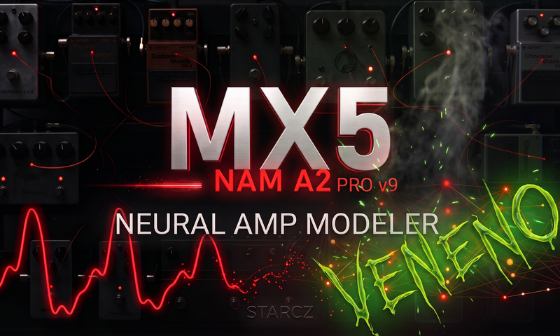

## Qué tan fiel es al NAM oficial

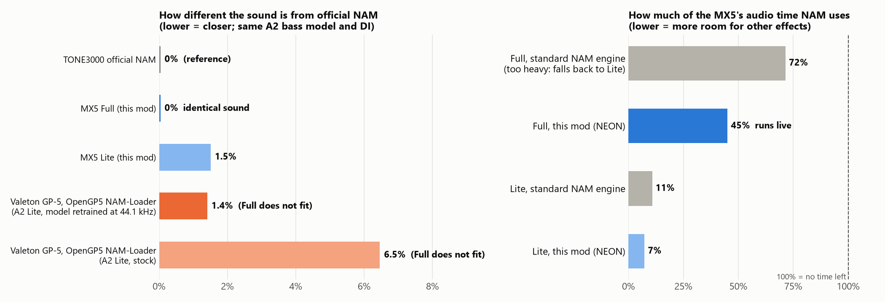

**Izquierda:** cuánto difiere el sonido del NAM oficial, con el mismo modelo A2 de bajo (AGONY DG1) y el mismo DI para todos. La MX5 Full es idéntica; la Lite es una red más chica y difiere un poco. Como referencia, la **Valeton GP-5** con el [NAM-Loader de OpenGP5](https://github.com/OpenGP5) (firmware abierto de terceros) solo admite A2 Lite: 6,5% con el loader original, 1,4% con un modelo reentrenado para su tasa de 44,1 kHz. **Derecha:** parte de cada bloque de audio de 1 ms que ocupa el NAM en la MX5. Con los motores NEON el Full ocupa 45% y corre en vivo, en un núcleo propio; con el motor estándar del NAM ocuparía 72% y bajaría a Lite. El motor del NAM es el mismo desde la v8, así que esta medición sigue valiendo en la v9.1.

| Modelo (A2) | High (Full) vs oficial | Low (Lite) vs oficial |
|---|---|---|
| Tech 21 Sansamp Bass Driver 01 | residuo -130,5 dB | -24,6 dB |
| Darkglass Fuzz - OMEGA | -134,1 dB | -26,5 dB |
| PP-DI-Only | -135,3 dB | -22,7 dB |
| B7K 6505+ Distorted Bass | -125,8 dB | -16,1 dB |

El residuo es la energía de la diferencia con la salida oficial. En **Full** queda en el redondeo de punto flotante de 32 bits: es el mismo sonido. Para repetirlo: `comparacao/run.sh`.

## Limitaciones conocidas (para la próxima ronda)

- En **Hardware Assign**, el NAM A2 Pro todavía aparece como "8-Bit Crush" (el Drop Starcz ya aparece bien).
- En la pantalla del NAM A2 Pro, INPUT, OUTPUT y MID muestran el número interno del pedal (por ejemplo, MID -15 dB = neutro).
- El Drop Starcz todavía hace algún chasquido esporádico en notas largas en la cuerda más grave.
- Girar rápido el TIMBRE del Drop Starcz hace un leve ruido mientras se mueve; el Gain del IR también, pero ese viene del firmware de fábrica.
- El IR estéreo, el IR2 y el IR del mezclador siguen como de fábrica.

## Próximas ideas

- **Synth para bajo.**
- Mejorar los otros pedales, igual que el drop y el IR.

## Camino hasta aquí

1. **Base.** NAM de lolgab (2 instancias) y MX5 Bridge 0.7 para usar MX-Edit en el PC. El build de lolgab se reprodujo byte a byte antes de cualquier cambio.
2. **v1, motores A2.** Port de los motores A2 Lite/Full de tone-3000/embedded a ARMv7 NEON, con selección automática en el equipo.
3. **v2, uso en vivo.** Llave Lite/Full, colapso mono, carga fuera del camino del audio, medidor en `/tmp/nam_a2_stats.txt`.
4. **v3 a v6.** Presets por modelo y sincronización automática (`nam-sync.sh`), rigs que se corrigen solos, descarte de `.nam` dañados.
5. **v7.** Arte propio de pedales, amps y gabinetes, nueva pantalla de inicio, acceso NAM A2 en el Model Selector, instalador con arte Starcz o de fábrica.
6. **v8.** NAM A2 Pro en el 8-Bit Crush con controles para bajo; NAM en un núcleo propio; instalador en tres idiomas.
7. **v9 / v9.1.** Cambio de modelo sin silencio (modelos listos en el núcleo 3), Drop Starcz en el lugar del Panner con TCHUG y TIGHT, IR largo con FFTConvolver en el núcleo 3, FULL y gate -40 dB por defecto, nueva pantalla de inicio e iconos de IR.

## Estructura

| Carpeta | Contenido |
|---|---|
| `motor/` | Motor: parches sobre lolgab, motores A2 (`t3k_a2.cpp`, `nam_armv7_neon.h`), scripts de build y pruebas. v8: `v8_nucleos.py`, `v8_pro.py`. v9: `v81_troca.py` y `v82_reserva.py` (cambio sin silencio), `drop_tune.h` + `v83_drop.py` (Drop Starcz), `v84_ir.py` + `v84_cauda.inc` + `fftconvolver/` (IR largo), `v9_ajustes.py` (valores por defecto). v9.1: `v91_panner.py` + `v91_tchug.inc` (Drop Starcz en el Panner, TCHUG y TIGHT), `v91_build.sh` |
| `firmware/v3` a `v91` | `nam-sync.sh` y los scripts que arman la imagen de cada versión, con sus pruebas (126 verificaciones en la v9.1) |
| `ferramentas/` | Herramientas que hablan con el equipo por la Bridge |
| `comparacao/` | Comparación con el NeuralAmpModelerCore oficial y los gráficos (`grafico.py`, `figuras_v91.py`) |
| `instalador/` | Instalador: `instalar.py` aplica el `payload/` sobre el firmware oficial; `dev/make_payload.py` genera el `payload/`; `bridge/` trae las bibliotecas de la MX5 Bridge 0.7 (MIT) |
| `docs/` | Imágenes de esta página (pantallas capturadas directo de la MX5 en `docs/v91/`) |

## Cómo compilar

Entorno usado: WSL Ubuntu 24.04, toolchain Bootlin `arm-buildroot-linux-gnueabihf` (glibc 2.31) en `/opt/toolchain`, `qemu-arm`, Python 3.12.

1. `motor/01_setup.sh` a `06_build.sh` descargan las fuentes, reproducen el build de lolgab, aplican los parches y generan `libnam_hook.so`. Para la v9.1, `motor/v91_build.sh` aplica encima todos los pasos de la v8 a la v9.1.
2. `firmware/v91/gen_build_v91.py` genera `build_v91.py`, que arma la imagen a partir de la v6 y ejecuta las pruebas.
3. El `Update.img` original 2.7 lo aporta usted. Los scripts tienen rutas de mi máquina; ajústelas.

## Fuentes y créditos

- [lolgab/headrush-nam-mod](https://github.com/lolgab/headrush-nam-mod): el mod de NAM para HeadRush en el que se basa (GPLv3).
- [tone-3000/embedded](https://github.com/tone-3000/embedded) 2.0.0: motores A2 Lite/Full (MIT).
- [sdatkinson/NeuralAmpModelerCore](https://github.com/sdatkinson/NeuralAmpModelerCore): implementación de referencia del NAM (MIT).
- [HiFi-LoFi/FFTConvolver](https://github.com/HiFi-LoFi/FFTConvolver): convolución por particiones usada en el IR largo (MIT).
- MX5 Bridge 0.7 y MX-Edit, de TicT4x: acceso USB-MIDI al equipo y editor de PC (MIT). Editor actual: [fork de MX-Edit](https://github.com/pagueobaixista-afk/MX-Edit).
- [SiulGalvan/Forge-Patch](https://github.com/SiulGalvan/Forge-Patch): paquete que integró NAM y Bridge; fue la base de la imagen con la Bridge (GPLv3).
- [iosumurillo/GIGBOARD_NAM_AMP_PNG](https://github.com/iosumurillo/GIGBOARD_NAM_AMP_PNG): mostró cómo cambiar las imágenes de los pedales en pantalla (GPLv3).
- [Eigen](https://eigen.tuxfamily.org) y [nlohmann/json](https://github.com/nlohmann/json), dependencias del NAM. Toolchains de [Bootlin](https://toolchains.bootlin.com).

**Arte de los pedales:** la opción 1 del instalador es arte original hecho para este mod (Starcz), incluido el Drop Starcz. La opción 2 usa las imágenes de fábrica, tomadas en la instalación del firmware oficial en su propio PC; no van en este paquete.

HeadRush y MX5 son marcas de inMusic; este proyecto no tiene relación con el fabricante.

## Licencia

GPLv3, por derivar de headrush-nam-mod. Ver `LICENSE`.

## Apoye el proyecto

Este mod se hace en el tiempo libre, con pruebas reales en ensayos y en el escenario, y con la ayuda de una IA paga (Claude Fable 5.2). Cada versión lleva muchas horas y mucho dinero en uso de IA. Si el mod le ayudó y quiere apoyar lo próximo (synth para bajo, mejores pedales), cualquier monto ayuda.

| Red | Monedas | Dirección |
|---|---|---|
| **EVM**: Ethereum, BNB Smart Chain, Base, Arbitrum One, Optimism, Polygon PoS, Avalanche C-Chain | ETH, BNB, POL, AVAX, USDC, USDT | `0x8dbd2Cbc766bD97Cd256d6778b604a19b2Ea461d` |
| **Solana** | SOL, USDC, USDT (SPL) | `3PgJBYaCo3Ld3QAAksGwSnF2eEbF3n7SBtWyDEdz33NN` |
| **TRON** | TRX, USDT (TRC-20) | `TL27vn9EFPSqyFDM9uUPNapDncqMBeVqfb` |
| **Bitcoin** (Native SegWit) | BTC | `bc1q4q3x9jr53sk2p95q8y466g24cxccxcw9mctgm3` |
| **Litecoin** (Native SegWit) | LTC | `ltc1q37rv4ue87myv29p8psk6ckrjpxjlpcln5gk35v` |

Verifique la red antes de enviar: monedas enviadas por la red equivocada pueden perderse. Exploradores: [Etherscan](https://etherscan.io/address/0x8dbd2Cbc766bD97Cd256d6778b604a19b2Ea461d) · [BscScan](https://bscscan.com/address/0x8dbd2Cbc766bD97Cd256d6778b604a19b2Ea461d) · [BaseScan](https://basescan.org/address/0x8dbd2Cbc766bD97Cd256d6778b604a19b2Ea461d) · [Arbiscan](https://arbiscan.io/address/0x8dbd2Cbc766bD97Cd256d6778b604a19b2Ea461d) · [PolygonScan](https://polygonscan.com/address/0x8dbd2Cbc766bD97Cd256d6778b604a19b2Ea461d) · [Solscan](https://solscan.io/account/3PgJBYaCo3Ld3QAAksGwSnF2eEbF3n7SBtWyDEdz33NN) · [TronScan](https://tronscan.org/#/address/TL27vn9EFPSqyFDM9uUPNapDncqMBeVqfb) · [Mempool](https://mempool.space/address/bc1q4q3x9jr53sk2p95q8y466g24cxccxcw9mctgm3) · [Blockchair](https://blockchair.com/litecoin/address/ltc1q37rv4ue87myv29p8psk6ckrjpxjlpcln5gk35v)

¡Gracias! 🤘
