# HeadRush MX5 NAM A2 Pro + Drop Starcz (v9.1)

**English** | [Português](README.pt-BR.md) | [Español](README.es.md)

Custom firmware for the **HeadRush MX5 (2.7)** that runs **NAM (Neural Amp Modeler)** models, including full-size **A2** models, and brings pedals rebuilt for bass: the **Drop Starcz** and the **long IR**.

**Made by a bass player, built for playing live.** v9.1 came out of rehearsals and shows: we fixed everything that got in the way on stage in the previous version. Changing the NAM model went silent for almost a second, the stock drop delayed the attack and took the weight away, the IR cut the tail and the gate killed the sound too early.

It is a derivative of [lolgab/headrush-nam-mod](https://github.com/lolgab/headrush-nam-mod) (v0.1.6), with the A2 engines from [tone-3000/embedded](https://github.com/tone-3000/embedded) ported to ARMv7 NEON, plus the [MX5 Bridge](#sources-and-credits) for accessing the unit from a PC. Project developed and built with **Claude Fable 5.2** (Anthropic).

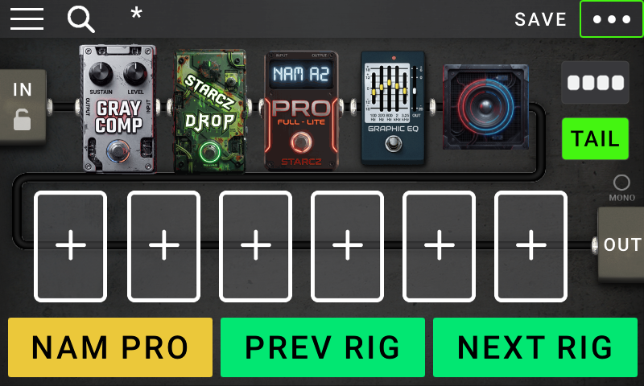

*The MX5 screen on v9.1: compressor, Drop Starcz, NAM A2 Pro, EQ and IR.*

> 💚 **Support the project.** Each version takes many hours of testing and costs a lot in AI usage. If the mod helped you, see the [donation wallets at the end of the page](#support-the-project).

> **Disclaimer.** Unofficial firmware, not affiliated with HeadRush/inMusic. Flashing modified firmware is at your own risk and may void your warranty; the authors are not responsible for any damage. This repository and the installer do **not** contain HeadRush firmware or the HeadRush updater: the installer starts from the official updater, downloaded from the inMusic website at install time. MX5 recovery: hold footswitches 1+2 while powering on and flash the official 2.7 updater (2+3 erases your rigs).

## What's new in v9.1, in plain words

### 1. Changing the NAM model with no gap in the sound

On v8, turning the MODEL NAM knob made the sound **disappear for almost a second** while the new model was built. Live, that is a hole in the middle of the song.

On v9.1 the models are **ready in memory before you need them** (the MX5 has 1 GB of RAM to spare). The change became a quick **~18 ms** crossfade, with no silence. In 321 changes measured on the unit, none went silent.

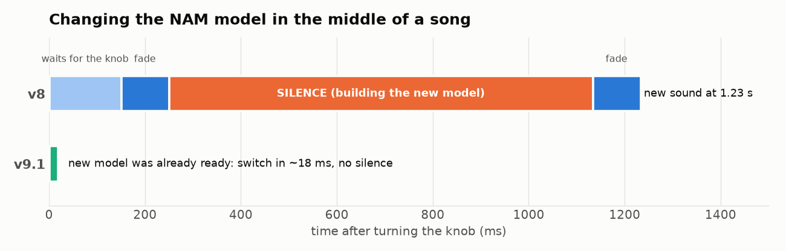

### 2. Drop Starcz: a new drop for bass

The stock Drop Tune delays the note's attack by ~12 ms and makes the sound "soft", bad for djent and industrial metal. **Drop Starcz** is a new algorithm made for bass:

- The attack comes out in **~2.5 ms** (the pick attack stays dry).
- Correct pitch (±1 cent), highs preserved.
- Light on the processor (~20 µs per block).

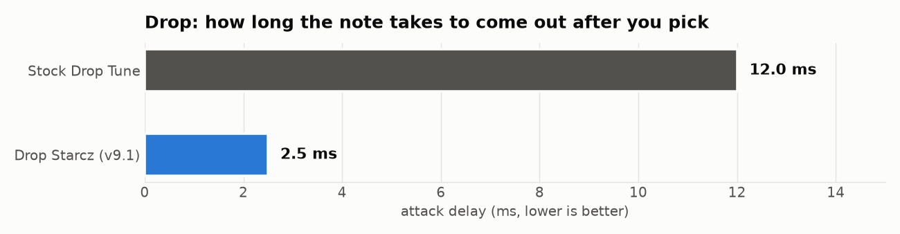

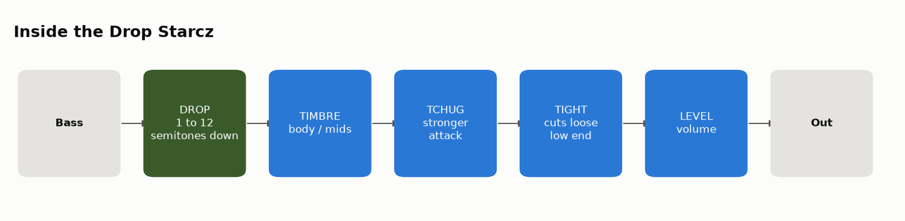

| Knob | What it does |
|---|---|
| **DROP** | How far down: Down 1 to Down 12 (12 = one octave). |
| **TIMBRE** | 0% = raw, 50% = neutral, 100% = more mids and body. |
| **LEVEL** | Volume, -12 to +12 dB (center = 0 dB). |
| **TCHUG** | Brings out palm-muted picking: stronger attack, drier tail. 0% = off. |
| **TIGHT** | Cuts the loose low end (sub) so riffs stay tight. 0% = off. |

It comes with presets: **+ DROP 1 to 7**, **+ OITAVA ABAIXO** (octave down), **DJENT -2/-4/-5**, **INDUSTRIAL -4**, **TCHUG MAX -4**, **SUB PESADO -4** (heavy sub) and **PALHETA SECA -4** (dry pick).

Drop Starcz takes the place of the **Panner** pedal (rarely used on bass). The **stock Drop Tune is still there**, unchanged, under Modulation: you can compare both in the same rig.

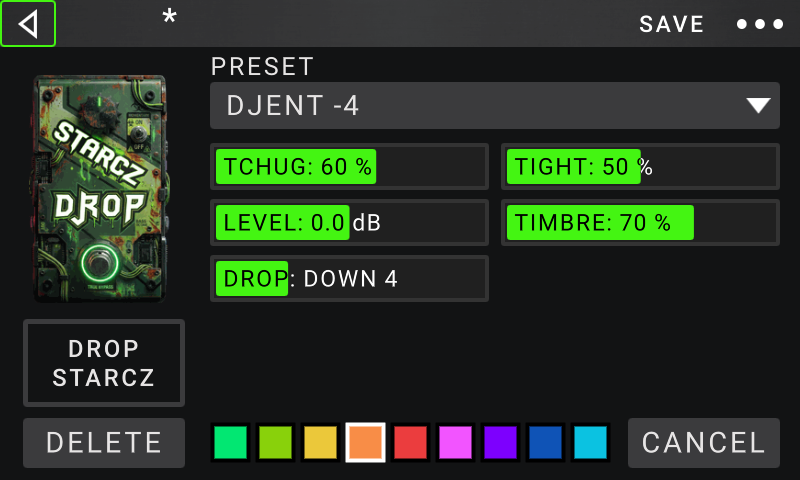 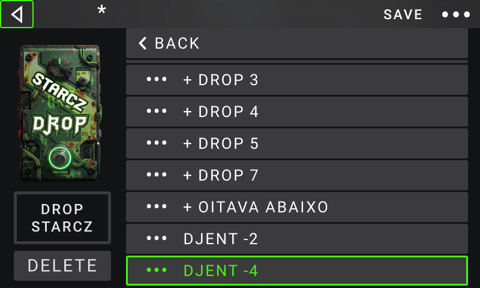

### 3. Long IR: the whole IR plays

Stock, the MX5 uses only the start of an IR file (2048 samples = 43 ms) and throws the rest away. Cabs with room, distant-mic IRs and reverbs lose their tail.

On v9.1 the **whole file plays (up to 12 s)**: the start stays in the stock block and the tail is computed separately, on processor core 3, without loading the audio (a 4.5 s reverb uses ~4% of that core).

- On a 1 s cab, the difference from the full IR went from -33 dB to -55 dB.
- **44.1 kHz** files work too.
- **Level is set automatically**: IRs that came in +7 to +14 dB hot (and clipped) land at a middle level, and you adjust with the knob.

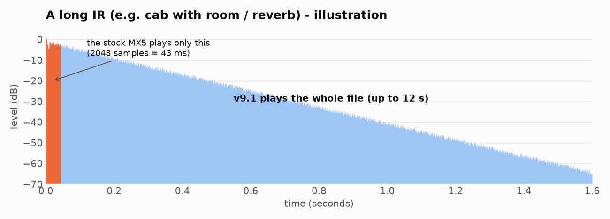

### 4. The whole processor put to work

The MX5 has a **4-core** processor, but stock almost everything runs on one and two sit idle. Since v8 NAM has a core of its own; on v9.1 the last free core prepares the models and computes the IR tail.

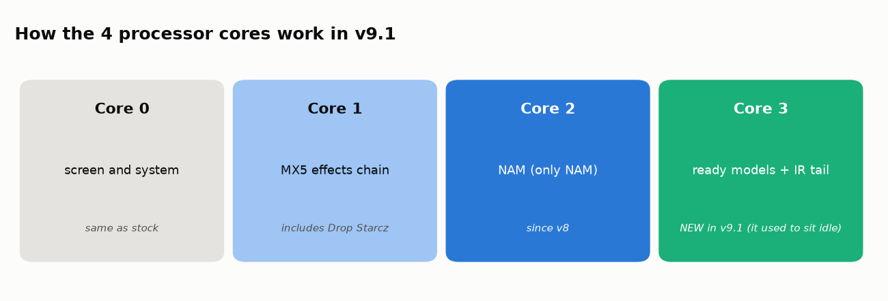

### 5. Better defaults for the stage

- **NAM on FULL by default** (sounds identical to official NAM). Rigs saved on LITE become FULL.
- **NAM gate at -40 dB** by default: on v8 it cut the end of the note too early.
- **Model Selector shortcuts**: NAM A2 and DROP STARCZ at the top, before Amp.

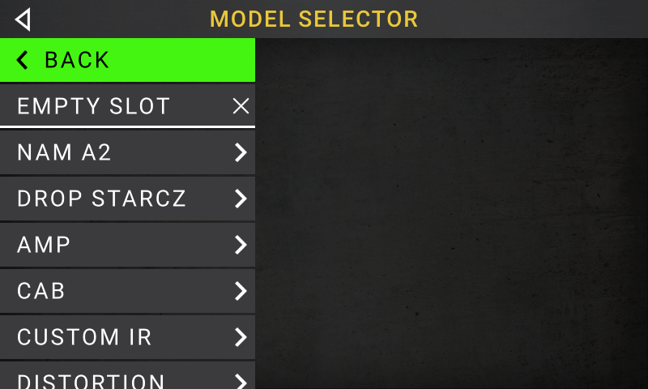 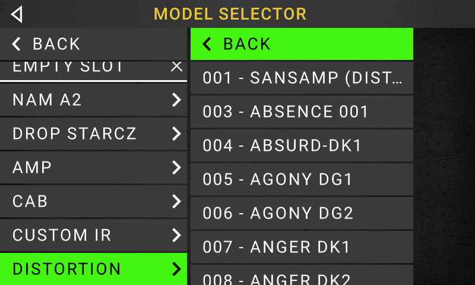

## NAM A2 Pro (in place of the 8-Bit Crush)

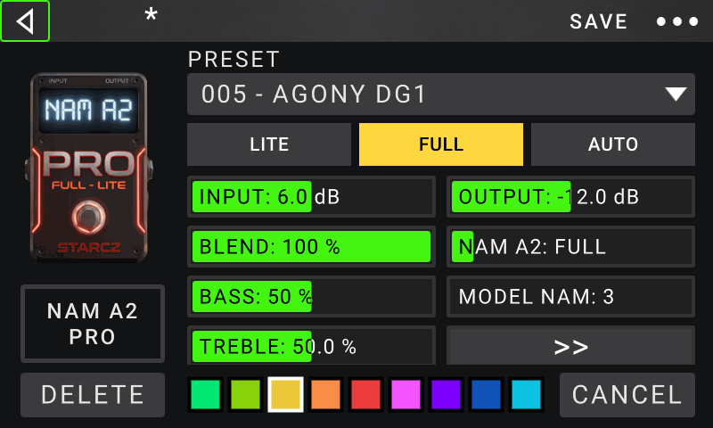 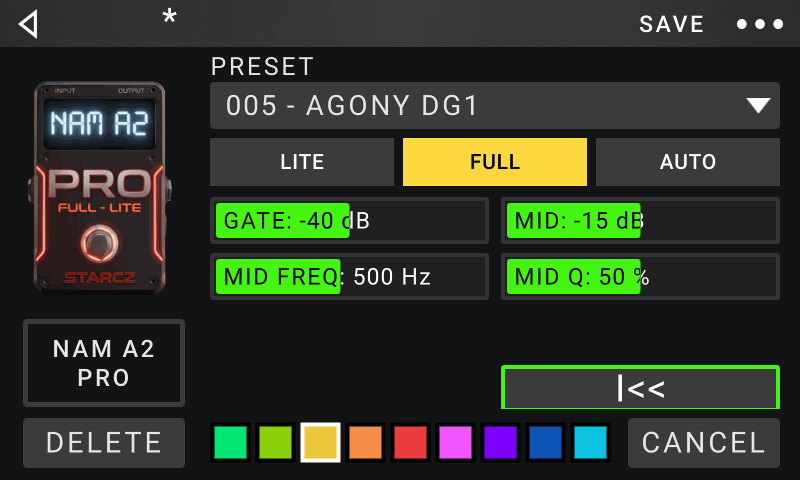

| On the screen | What it does |
|---|---|
| **LITE / FULL / AUTO** | Model size. **FULL** sounds identical to official NAM; **LITE** is lighter on the processor; **AUTO** picks by itself. |
| **MODEL NAM** | Picks the model. **1 knob click = 1 model.** You can also pick by name in the presets list. |
| **INPUT / OUTPUT** | Gain into the model and volume out. |
| **BLEND** | Mix of clean bass and NAM. 100% = only NAM. Below that, the clean low end stays tight under the distortion. |
| **BASS / TREBLE / MID / MID FREQ / MID Q** | EQ after NAM. MID Q at 0% = EQ OFF. |
| **GATE** | Cuts noise when you are not playing (OFF at minimum). |

**How Sync works:** copy your `.nam` files to the `NAM` folder on the MX5 drive and tap **Sync**. The MX5 numbers new files by itself (`NNN - name`), and 10 to 60 seconds later the **app restarts by itself once** to create the presets and fix saved rigs. It is not a freeze: do not power off.

## How to install (step by step)

1. Go to **[Releases](../../releases/latest)** and download **`MX5_NAM_A2_v9.1.zip`**. Extract it.
2. Double-click **`Instalar_MX5_NAM_A2_v9.1.exe`** (keep the `_instalador_arquivos` folder next to it). Pick the language and the art (1 = Starcz, 2 = factory). It downloads the official HeadRush 2.7 updater and builds the firmware (about 2 minutes). If Windows or your antivirus warns, click **More info > Run anyway** (no paid code-signing certificate; the source is here).
3. Plug the MX5 into power and USB. On the MX5: **Global Settings > … > Firmware Update**.
4. Open **`FirmwareUpdater.exe`** in the `MX5_NAM_A2_v9.1_ARTE_…_PRONTO_PARA_GRAVAR` folder ("ready to flash") and click **Instalar NAM A2 v9.1**. Do not disconnect until it finishes.
5. Copy your `.nam` files to the **`NAM`** folder and tap **Sync**.
6. PC editor: **`MX-Edit\MX-Edit.exe`** (portable, art included).

**Coming from v8:** just flash over it. NAM presets created by v8 stay as they were (AUTO, gate off); to use FULL and the -40 dB gate on them, change them on the pedal and save. v8 is no longer offered for download: v9.1 replaces it.

**To go back to stock:** flash the official HeadRush 2.7 updater. **If the MX5 does not boot:** hold footswitches 1+2 while powering on and flash the official updater.

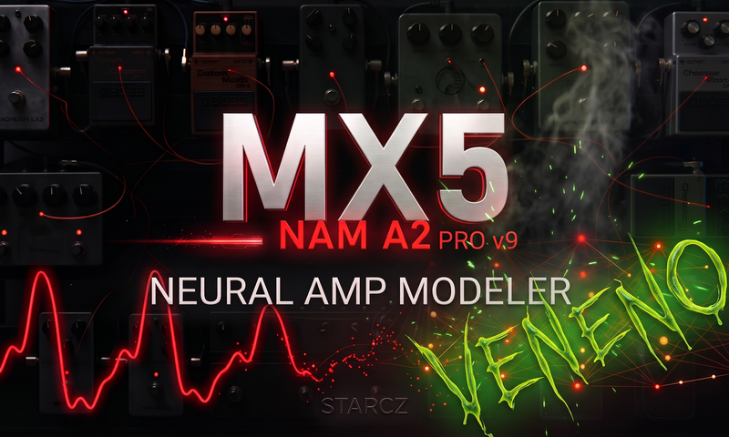

## How faithful it is to official NAM

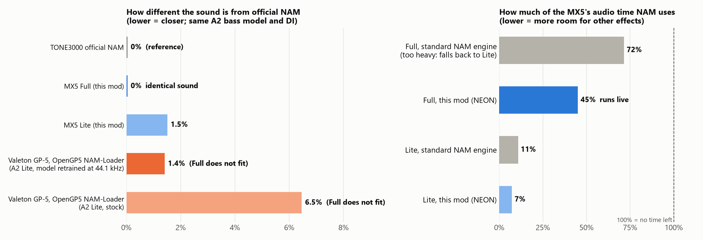

**Left:** how much of the sound differs from official NAM, with the same A2 bass model (AGONY DG1) and the same DI for everyone. MX5 Full is identical; Lite is a smaller network and differs a little. For reference, the **Valeton GP-5** running the open third-party [OpenGP5 NAM-Loader](https://github.com/OpenGP5) only fits A2 Lite: 6.5% with the stock loader, 1.4% with a model retrained for its 44.1 kHz rate. **Right:** share of each 1 ms audio block that NAM takes on the MX5. With the NEON engines Full takes 45% and runs live, on its own core; the standard NAM engine would take 72% and fall back to Lite. The NAM engine is the same since v8, so this measurement still holds on v9.1.

| Model (A2) | High (Full) vs official | Low (Lite) vs official |
|---|---|---|
| Tech 21 Sansamp Bass Driver 01 | residual -130.5 dB | -24.6 dB |
| Darkglass Fuzz - OMEGA | -134.1 dB | -26.5 dB |
| PP-DI-Only | -135.3 dB | -22.7 dB |
| B7K 6505+ Distorted Bass | -125.8 dB | -16.1 dB |

Residual is the energy of the difference from the official output. In **Full** it sits at 32-bit floating-point rounding: it is the same sound. To reproduce: `comparacao/run.sh`.

## Known limitations (for the next round)

- In **Hardware Assign**, NAM A2 Pro still shows as "8-Bit Crush" (Drop Starcz already shows correctly).
- On the NAM A2 Pro screen, INPUT, OUTPUT and MID show the pedal's internal number (for example, MID -15 dB = neutral).
- Drop Starcz still pops now and then on long notes on the lowest string.
- Turning the Drop Starcz TIMBRE quickly makes a slight noise while it moves; the IR Gain does too, but that one comes from the stock firmware.
- Stereo IR, IR2 and the mixer IR are still stock.

## Next ideas

- **Bass synth.**
- Improve the other pedals the same way as the drop and the IR.

## How we got here

1. **Base.** lolgab's NAM (2 instances) and MX5 Bridge 0.7 to use MX-Edit on the PC. lolgab's build was reproduced byte for byte before any change.
2. **v1, A2 engines.** Port of the A2 Lite/Full engines from tone-3000/embedded to ARMv7 NEON, with automatic selection on the unit.
3. **v2, used live.** Lite/Full switch, mono collapse, loading off the audio path, `/tmp/nam_a2_stats.txt` meter.
4. **v3 to v6.** Presets per model and automatic sync (`nam-sync.sh`), self-fixing rigs, discarding broken `.nam` files.
5. **v7.** Own art for pedals, amps and cabs, new boot screen, NAM A2 shortcut in the Model Selector, installer with Starcz or factory art.
6. **v8.** NAM A2 Pro on the 8-Bit Crush with bass-oriented controls; NAM on its own core; installer in three languages.
7. **v9 / v9.1.** Model change with no silence (models ready on core 3), Drop Starcz in place of the Panner with TCHUG and TIGHT, long IR with FFTConvolver on core 3, FULL and -40 dB gate by default, new boot screen and IR icons.

## Layout

| Folder | Contents |
|---|---|
| `motor/` | Engine: patches on top of lolgab, A2 engines (`t3k_a2.cpp`, `nam_armv7_neon.h`), build and test scripts. v8: `v8_nucleos.py`, `v8_pro.py`. v9: `v81_troca.py` and `v82_reserva.py` (silent-free change), `drop_tune.h` + `v83_drop.py` (Drop Starcz), `v84_ir.py` + `v84_cauda.inc` + `fftconvolver/` (long IR), `v9_ajustes.py` (defaults). v9.1: `v91_panner.py` + `v91_tchug.inc` (Drop Starcz on the Panner, TCHUG and TIGHT), `v91_build.sh` |
| `firmware/v3` to `v91` | `nam-sync.sh` and the scripts that build each version's image, with their tests (126 checks on v9.1) |
| `ferramentas/` | Tools that talk to the unit over the Bridge |
| `comparacao/` | Comparison against the official NeuralAmpModelerCore and the charts (`grafico.py`, `figuras_v91.py`) |
| `instalador/` | Installer: `instalar.py` applies `payload/` to the official firmware; `dev/make_payload.py` generates `payload/`; `bridge/` holds the MX5 Bridge 0.7 libraries (MIT) |
| `docs/` | Images for this page (screens captured straight from the MX5 in `docs/v91/`) |

## How to build

Environment used: WSL Ubuntu 24.04, Bootlin toolchain `arm-buildroot-linux-gnueabihf` (glibc 2.31) in `/opt/toolchain`, `qemu-arm`, Python 3.12.

1. `motor/01_setup.sh` through `06_build.sh` fetch the sources, reproduce lolgab's build, apply the patches and produce `libnam_hook.so`. For v9.1, `motor/v91_build.sh` applies every step from v8 to v9.1 on top.
2. `firmware/v91/gen_build_v91.py` generates `build_v91.py`, which builds the image from v6 and runs the tests.
3. You must supply the original 2.7 `Update.img` yourself. The scripts contain paths from my machine; adjust them.

## Sources and credits

- [lolgab/headrush-nam-mod](https://github.com/lolgab/headrush-nam-mod): the HeadRush NAM mod this is based on (GPLv3).
- [tone-3000/embedded](https://github.com/tone-3000/embedded) 2.0.0: A2 Lite/Full engines (MIT).
- [sdatkinson/NeuralAmpModelerCore](https://github.com/sdatkinson/NeuralAmpModelerCore): NAM reference implementation (MIT).
- [HiFi-LoFi/FFTConvolver](https://github.com/HiFi-LoFi/FFTConvolver): partitioned convolution used for the long IR (MIT).
- MX5 Bridge 0.7 and MX-Edit, by TicT4x: USB-MIDI access to the unit and PC editor (MIT). Current editor: [MX-Edit fork](https://github.com/pagueobaixista-afk/MX-Edit).
- [SiulGalvan/Forge-Patch](https://github.com/SiulGalvan/Forge-Patch): package integrating NAM and Bridge; it was the basis of the image with the Bridge (GPLv3).
- [iosumurillo/GIGBOARD_NAM_AMP_PNG](https://github.com/iosumurillo/GIGBOARD_NAM_AMP_PNG): showed how to swap the on-screen pedal images (GPLv3).
- [Eigen](https://eigen.tuxfamily.org) and [nlohmann/json](https://github.com/nlohmann/json), NAM dependencies. Toolchains from [Bootlin](https://toolchains.bootlin.com).

**Pedal artwork:** option 1 of the installer is original art drawn for this mod (Starcz), including the Drop Starcz. Option 2 uses the factory images, taken at install time from the official firmware on your own PC; they are not shipped here.

HeadRush and MX5 are trademarks of inMusic; this project is not affiliated with the manufacturer.

## License

GPLv3, as a derivative of headrush-nam-mod. See `LICENSE`.

## Support the project

This mod is made in spare time, tested for real at rehearsals and on stage, with the help of a paid AI (Claude Fable 5.2). Each version takes many hours and a lot of money in AI usage. If the mod helped you and you want to support the next steps (bass synth, better pedals), any amount helps.

| Network | Coins | Address |
|---|---|---|
| **EVM**: Ethereum, BNB Smart Chain, Base, Arbitrum One, Optimism, Polygon PoS, Avalanche C-Chain | ETH, BNB, POL, AVAX, USDC, USDT | `0x8dbd2Cbc766bD97Cd256d6778b604a19b2Ea461d` |
| **Solana** | SOL, USDC, USDT (SPL) | `3PgJBYaCo3Ld3QAAksGwSnF2eEbF3n7SBtWyDEdz33NN` |
| **TRON** | TRX, USDT (TRC-20) | `TL27vn9EFPSqyFDM9uUPNapDncqMBeVqfb` |
| **Bitcoin** (Native SegWit) | BTC | `bc1q4q3x9jr53sk2p95q8y466g24cxccxcw9mctgm3` |
| **Litecoin** (Native SegWit) | LTC | `ltc1q37rv4ue87myv29p8psk6ckrjpxjlpcln5gk35v` |

Check the network before sending: coins sent on the wrong network can be lost. Explorers: [Etherscan](https://etherscan.io/address/0x8dbd2Cbc766bD97Cd256d6778b604a19b2Ea461d) · [BscScan](https://bscscan.com/address/0x8dbd2Cbc766bD97Cd256d6778b604a19b2Ea461d) · [BaseScan](https://basescan.org/address/0x8dbd2Cbc766bD97Cd256d6778b604a19b2Ea461d) · [Arbiscan](https://arbiscan.io/address/0x8dbd2Cbc766bD97Cd256d6778b604a19b2Ea461d) · [PolygonScan](https://polygonscan.com/address/0x8dbd2Cbc766bD97Cd256d6778b604a19b2Ea461d) · [Solscan](https://solscan.io/account/3PgJBYaCo3Ld3QAAksGwSnF2eEbF3n7SBtWyDEdz33NN) · [TronScan](https://tronscan.org/#/address/TL27vn9EFPSqyFDM9uUPNapDncqMBeVqfb) · [Mempool](https://mempool.space/address/bc1q4q3x9jr53sk2p95q8y466g24cxccxcw9mctgm3) · [Blockchair](https://blockchair.com/litecoin/address/ltc1q37rv4ue87myv29p8psk6ckrjpxjlpcln5gk35v)

Thank you! 🤘
