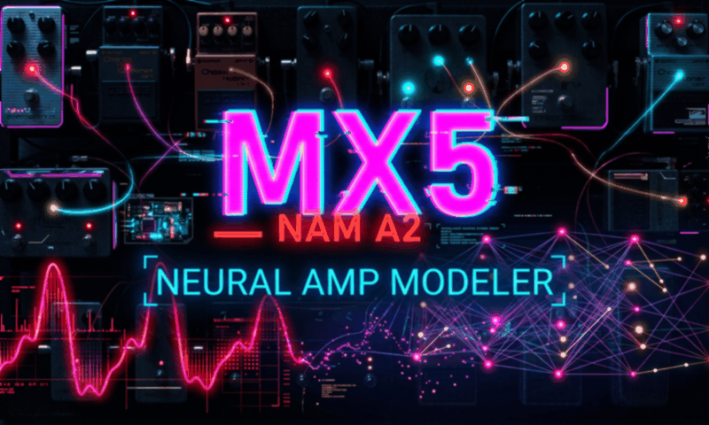
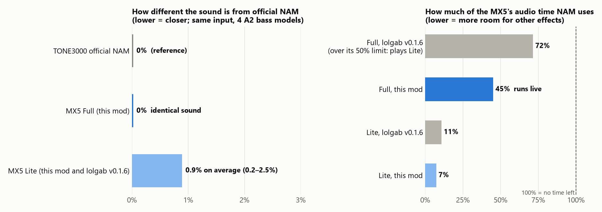

# HeadRush MX5 NAM A2 Full/Lite

**English** | [Português](README.pt-BR.md) | [Español](README.es.md)

Custom firmware for the **HeadRush MX5 (2.7)** that runs **NAM (Neural Amp Modeler)** models, including full-size **A2** models, with a model list that maintains itself.

It is a derivative of [lolgab/headrush-nam-mod](https://github.com/lolgab/headrush-nam-mod) (v0.1.6), with the A2 engines from [tone-3000/embedded](https://github.com/tone-3000/embedded) ported to ARMv7 NEON, plus the [MX5 Bridge](#sources-and-credits) for accessing the unit from a PC.

Project developed and built with **Claude Fable 5.2** (Anthropic).

*The same rig in MX-Edit on the PC, with the picture of each pedal, and on the MX5 screen (with the NAM A2 pedal).*

**PC editor:** [HeadRush MX5 PC Editor (MX-Edit fork)](https://github.com/pagueobaixista-afk/MX-Edit) – connects to the MX5 right away on Windows 11 and shows the picture of each pedal. The installer of this project already includes it.

> **Disclaimer.** Unofficial firmware, not affiliated with HeadRush/inMusic. Flashing modified firmware is at your own risk and may void your warranty; the authors are not responsible for any damage. This repository and the installer do **not** contain HeadRush firmware or the HeadRush updater: the installer starts from the official updater, downloaded from the inMusic website at install time. MX5 recovery: hold footswitches 1+2 while powering on and flash the official 2.7 updater (2+3 erases your rigs).

## 🎬 Videos

- **Demo (v7):** [NAM A2 Full/Lite playing on the HeadRush MX5](https://youtu.be/nuovUCALZjI): boot screen, NAM A2 menu and the Lite/Full switch.
- **How to install:** [step-by-step video](https://youtu.be/1Bj1k44fe2Y) (recorded with v6; v7 installs the same way and only adds the art question).

## What's new in v7

- **NAM A2 has its own name and menu.** The pedal shows as **NAM A2** everywhere on the screen, and the Model Selector has a **NAM A2** button (between Empty Slot and Amp) that opens the NAM model list directly.
- **Pedal screen made for NAM:** Drive shows as **MODEL NAM: N** (the model number) and the Hi-Lo switch as **NAM A2 LITE / FULL**.
- **Two art options, picked in the installer:**
  1. **Starcz art** (recommended): new pedal, amp and cab images and a new boot screen, drawn for this mod.
  2. **Factory art:** the original HeadRush images and boot screen (taken from the official firmware on your PC; they are not shipped here).
- Credit line in Global Settings (under the inMusic notice, which is unchanged).
- NAM engine, sound and `nam-sync.sh` are the same as v6. Internally the pedal is still "Anxiety OD", so rigs, presets and the PC editor keep working.

## How to install (step by step)

1. Go to **[Releases](../../releases/latest)** and download **`MX5_NAM_A2_v7.zip`**.
2. Right-click the zip > **Extract All**.
3. In the extracted folder, double-click **`Instalar_MX5_NAM_A2_v7.exe`**.
   - It asks which art you want: type **1** (Starcz art) or **2** (factory art) and press Enter.
   - It downloads the official HeadRush 2.7 updater, builds the firmware and verifies everything (about 2 minutes).
   - If Windows shows "Windows protected your PC", click **More info > Run anyway** (the program has no paid code-signing certificate).
   - No internet: drag the official updater you already have onto the `.exe`.
4. A folder named **`MX5_NAM_A2_v7_ARTE_STARCZ_PRONTO_PARA_GRAVAR`** (or `..._ARTE_ORIGINAL_...`) ("ready to flash") will appear.
5. Plug the MX5 into power and into the PC via USB. On the MX5: **Global Settings > … > Firmware Update**.
6. Open **`FirmwareUpdater.exe`** from that folder and click **Instalar NAM A2 v7** ("Install"). Do not disconnect until it finishes.
7. Copy your `.nam` files to the **`NAM`** folder on the MX5 drive, eject, and tap **Sync**. The models show up as presets of the **NAM A2** pedal (Model Selector > **NAM A2**).
8. To edit on the PC, open **`MX-Edit\MX-Edit.exe`** (close any other MX-Edit first). The installer puts in `MX-Edit\arte` the same pedal, amp and cabinet images the MX5 shows on its screen.

**To go back to stock:** flash the official HeadRush 2.7 updater the same way. **To switch art:** run the installer again, pick the other option and flash it. Coming from v6 you can flash v7 directly; your rigs and NAM folder stay.

> The installer and on-device messages are currently in Portuguese.

## What it does

- **NAM inside the Anxiety OD pedal.** The Drive knob picks the model (its position in the `NAM` folder), Tone is input gain and Level is output gain.
- **A2 Lite and Full via the Hi-Lo switch.** Low = reduced submodel (Lite), High = full model (Full). You can flip it while playing.
- **Faster A2 engines.** The `t3k` engines ported to NEON are chosen by benchmarking on the unit itself. Measured on the MX5: Full went from 715 µs to 451 µs per 48-sample block (1.58×), Lite from 108 to 73 µs. A block lasts 1000 µs.
- **Less wasted load.** Mono signal (L equal to R) is processed only once; the active-instance count was fixed; model-loading threads run off the audio core and below audio priority.
- **Model list like an IR loader.** Each `.nam` becomes an Anxiety OD preset named `NNN - name`.
- **Automatic sync** (`nam-sync.sh`), at boot and when leaving USB transfer (Sync):
  - numbers new `.nam` files with the next free number, so existing positions don't change;
  - validates files and moves broken ones to `NAM/_com_defeito`;
  - creates, updates and removes presets;
  - fixes Drive in saved rigs if a model changes position (backing up the database first);
  - sets the preset Level from the model's `metadata.loudness` (optional, see below);
  - restarts the app by itself when the list changed and writes a report to `NAM/nam_sync_relatorio.txt`.

Control files in the `NAM` folder: `nam_config.txt` (`quality=switch|lite|full|auto`), `nam_sync.txt` (`alvo=` target level, `nivelar=0` disables leveling), `nam_sync_off.txt`, `nam_restart_off.txt`.

**About volume leveling:** it evens out perceived loudness, but changes how hard the model drives the following blocks in the rig, and some end up clipping. In practice Level needs manual adjustment per rig; use `nivelar=0` if you prefer all of them at 50.

## How faithful it is to official NAM

Direct comparison: the same audio (2 s of the NeuralAmpModelerCore test signal + 10 s of DI bass, 48 kHz) was run through the official [NeuralAmpModelerCore](https://github.com/sdatkinson/NeuralAmpModelerCore) built on a PC and through the `libnam_hook.so` identical to the one on the unit (same SHA1), running under `qemu-arm` with the firmware's libraries, `t3k-mla` engine, Tone and Level at 0 dB.

**Left:** how much of the sound differs from official NAM (energy of the difference, same input). Full is identical; Lite is a smaller network and differs a little, more on high-gain models. **Right:** share of each 1 ms audio block that NAM takes on the MX5. With the NEON engines Full takes 45% and runs live. In the base firmware, [lolgab/headrush-nam-mod](https://github.com/lolgab/headrush-nam-mod) v0.1.6, Full would take 72%, over its 50% limit, so A2 models play as Lite there (its Lite output is bit-exact with this mod's Lite, checked in `motor/07_test.sh`).

Exact numbers:

| Model (A2) | High (Full) vs official | Low (Lite) vs official |
|---|---|---|
| Tech 21 Sansamp Bass Driver 01 | residual -130.5 dB | -24.6 dB |
| Darkglass Fuzz - OMEGA | -134.1 dB | -26.5 dB |
| PP-DI-Only | -135.3 dB | -22.7 dB |
| B7K 6505+ Distorted Bass | -125.8 dB | -16.1 dB |

Residual is the energy of the difference from the official output. In **Full** there is no delay or level difference, and the residual is at 32-bit floating-point rounding: it is the same sound. **Lite** runs the reduced submodel shipped inside the `.nam` itself, a smaller network, and the difference is audible on higher-gain models.

What this measurement does not cover: the MX5's converters and input stage, and whatever comes before and after NAM in the rig. To reproduce: `comparacao/run.sh`.

## How we got here

1. **Base.** lolgab's NAM (2 instances) and MX5 Bridge 0.7 to use MX-Edit on the PC. lolgab's build was reproduced byte for byte before any change.
2. **v1, A2 engines.** Port of the A2 Lite/Full engines from tone-3000/embedded to ARMv7 NEON (`fma` and `mla` variants), with automatic selection on the unit and a report at `/tmp/nam_a2_report.txt`. Tested in qemu-arm and then measured on the MX5.
3. **v2, used live.** Hi-Lo switch as the Lite/Full selector (byte found by memory diffing, `memscan.c` and `hilo_probe.py`), mono collapse, instance count, loading threads off the audio path, `/tmp/nam_a2_stats.txt` meter. A whole show without a single block overrun.
4. **Per-model presets.** Anxiety OD presets written to the unit's SQLite database via the Bridge (`ferramentas/nam_presets.py`).
5. **v3.** Sync at boot (`nam-sync.sh`, called from `runevil`).
6. **v4.** Sync also when leaving USB transfer (`mount_usb_img`) and automatic app restart.
7. **v5.** Self-fixing rigs, loudness leveling, discarding broken `.nam` files, report.
8. **v6.** Fix: when finishing its own Sync, the app rewrote the database from memory and wiped the freshly created presets. Now the database is only changed after the app finishes (`deferred` mode), and then the app is restarted.

Dropped along the way: rescanning the folder without restarting the app (risk to audio) and replacing the Anxiety OD with another pedal.

## Layout

| Folder | Contents |
|---|---|
| `motor/` | Patches on top of lolgab (`nam_hook.diff`, `model_cpp.diff`), engines (`t3k_a2.cpp`, `nam_armv7_neon.h`), numbered build and test scripts, `harness.c`, Bridge client (`brq.py`) |
| `firmware/v3` to `v6` | `nam-sync.sh` for each version, scripts that build the image (`build_vN.py`) and the filesystem check |
| `ferramentas/` | Preset sync from the PC, via Bridge |
| `comparacao/` | Comparison against the official NeuralAmpModelerCore |
| `editor/` | Patch on [MX-Edit](https://github.com/TicT4x/MX-Edit) 0.9.5 (TicT4x, MIT): real block artwork (PNGs from `arte/`, same naming rule as the MX5 QML) and reliable connection (0.3 s pause after opening the MIDI port: without it the first ping was lost 8 out of 8 times; retries; keeps searching for the MX5 until found) |
| `instalador/` | Beginner-friendly installer: `instalar.py` applies `payload/` (new files, only the changed lines of HeadRush scripts, and 38 bytes of `/usr/Evil/Evil`) to the official firmware; `dev/make_payload.py` generates `payload/` from v6; `bridge/` holds the MX5 Bridge 0.7 libraries (MIT) |

## How to build

Environment used: WSL Ubuntu 24.04, Bootlin toolchain `arm-buildroot-linux-gnueabihf` (glibc 2.31) in `/opt/toolchain`, `qemu-arm`, Python 3.12.

1. `motor/01_setup.sh` through `06_build.sh` fetch the sources, reproduce lolgab's build, apply the patches and produce `libnam_hook.so`. `07_test.sh` onward are the tests.
2. `motor/build_a2.py` inserts the engine into a base image that already has the Bridge. `firmware/vN/build_vN.py` applies each version on top of the previous one and runs the build tests.
3. You must supply the original 2.7 `Update.img` and the MX5 Bridge 0.7 patcher yourself. The scripts contain paths from my machine; adjust them.

## Sources and credits

- [lolgab/headrush-nam-mod](https://github.com/lolgab/headrush-nam-mod): the HeadRush NAM mod this is based on (GPLv3).
- [tone-3000/embedded](https://github.com/tone-3000/embedded) 2.0.0: A2 Lite/Full engines (MIT).
- [sdatkinson/NeuralAmpModelerCore](https://github.com/sdatkinson/NeuralAmpModelerCore): NAM reference implementation (MIT).
- MX5 Bridge 0.7 and MX-Edit 0.9.5, by TicT4x: USB-MIDI access to the unit and PC editor (MIT).
- [SiulGalvan/Forge-Patch](https://github.com/SiulGalvan/Forge-Patch) ("HEADRUSH MX5 Compatibility Layer"): package integrating NAM, Bridge and artwork; it was the basis of the image with the Bridge (GPLv3).
- [iosumurillo/GIGBOARD_NAM_AMP_PNG](https://github.com/iosumurillo/GIGBOARD_NAM_AMP_PNG): on-screen pedal artwork patch (GPLv3).
- [Eigen](https://eigen.tuxfamily.org) and [nlohmann/json](https://github.com/nlohmann/json), NAM dependencies.
- Toolchains from [Bootlin](https://toolchains.bootlin.com).

**Pedal artwork:** the pedal images are HeadRush (inMusic) material, integrated by iosumurillo and Forge-Patch. They are not part of this repository: they ship separately, as `arte_pedais.bin` in the Release zip, only for use on the user's own MX5. Without that file, the installer builds the firmware without the artwork. Rights holders who want it removed can open an issue; the file will be taken down immediately.

HeadRush and MX5 are trademarks of inMusic; this project is not affiliated with the manufacturer.

## License

GPLv3, as a derivative of headrush-nam-mod. See `LICENSE`.
