# HeadRush MX5 NAM A2 Pro + Drop Starcz (v9.1)

[English](README.md) | **Português** | [Español](README.es.md)

Firmware personalizado para o **HeadRush MX5 (2.7)** que roda modelos **NAM (Neural Amp Modeler)**, incluindo os modelos **A2** no tamanho completo, e traz pedais refeitos para baixo: o **Drop Starcz** e o **IR longo**.

**Feito por um baixista, pensado para tocar ao vivo.** A v9.1 nasceu de ensaios e shows: corrigimos tudo o que atrapalhava no palco na versão anterior. A troca de modelo NAM ficava quase 1 segundo muda, o drop de fábrica atrasava o ataque e tirava o peso, o IR cortava a cauda e o gate matava o som cedo demais.

É um trabalho derivado de [lolgab/headrush-nam-mod](https://github.com/lolgab/headrush-nam-mod) (v0.1.6), com os motores A2 de [tone-3000/embedded](https://github.com/tone-3000/embedded) portados para ARMv7 NEON e a [MX5 Bridge](#fontes-e-créditos) para acesso ao aparelho pelo PC. Projeto desenvolvido e compilado com o **Claude Fable 5.2** (Anthropic).

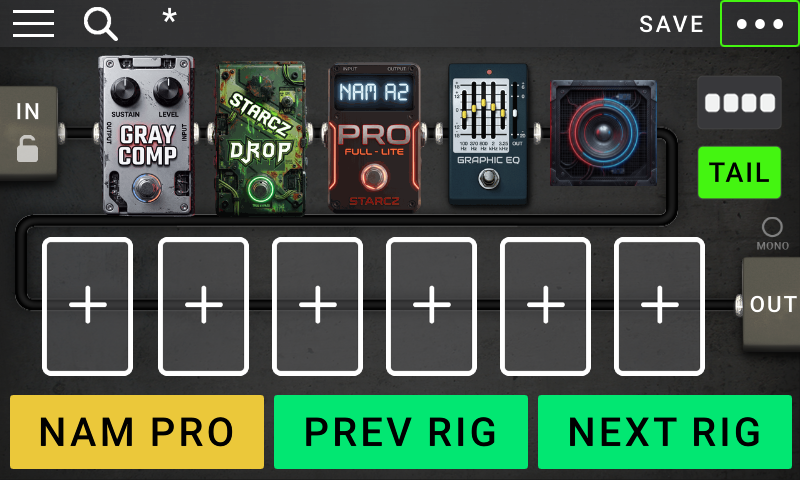

*Tela da MX5 com a v9.1: compressor, Drop Starcz, NAM A2 Pro, EQ e IR.*

> 💚 **Apoie o projeto.** Cada versão leva muitas horas de testes e custa caro em uso de IA. Se o mod te ajudou, veja as [carteiras para doação no fim da página](#apoie-o-projeto).

> **Aviso.** Firmware não oficial, sem vínculo com a HeadRush/inMusic. Gravar firmware modificado é por sua conta e risco e pode anular a garantia; os autores não se responsabilizam por danos. O repositório e o instalador **não** contêm o firmware nem o atualizador da HeadRush: o instalador parte do atualizador oficial, baixado do site da inMusic na hora. Recuperação da MX5: footswitches 1+2 ao ligar e gravar o atualizador oficial 2.7 (2+3 apaga os rigs).

## Novidades da v9.1, em palavras simples

### 1. Troca de modelo NAM sem buraco no som

Na v8, ao girar o botão MODEL NAM, o som **sumia por quase 1 segundo** enquanto o modelo novo era montado. Ao vivo, isso é um buraco no meio da música.

Na v9.1, os modelos ficam **prontos na memória antes de você precisar deles** (a MX5 tem 1 GB de RAM sobrando para isso). A troca virou um cruzamento rápido de volume de **~18 ms**, sem silêncio. Em 321 trocas medidas no aparelho, nenhuma ficou muda.

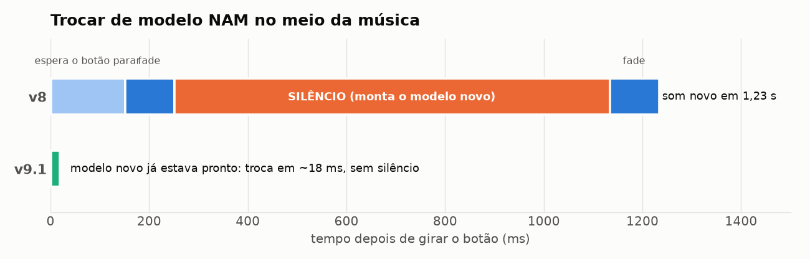

### 2. Drop Starcz: drop novo para baixo

O Drop Tune de fábrica atrasa o ataque da nota em ~12 ms e deixa o som "mole", ruim para djent e metal industrial. O **Drop Starcz** é um algoritmo novo, feito para baixo:

- O ataque sai em **~2,5 ms** (a palhetada continua seca).
- Afinação certa (±1 cent) e agudos preservados.
- Pesa pouco no processador (~20 µs por bloco).

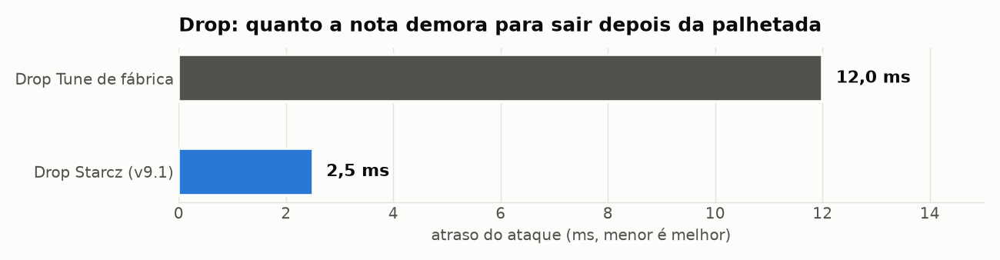

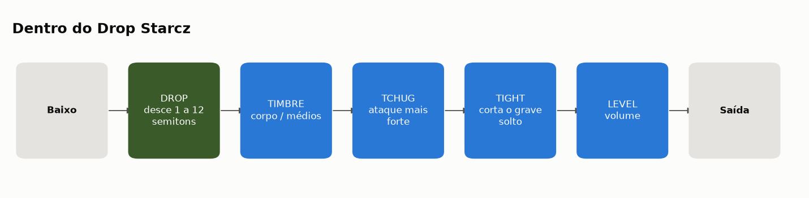

| Botão | O que faz |
|---|---|
| **DROP** | Quanto desce: Down 1 a Down 12 (12 = uma oitava abaixo). |
| **TIMBRE** | 0% = cru, 50% = neutro, 100% = mais médios e corpo. |
| **LEVEL** | Volume, de -12 a +12 dB (centro = 0 dB). |
| **TCHUG** | Realça a palhetada abafada: ataque mais forte e cauda mais seca. 0% = desligado. |
| **TIGHT** | Corta o grave solto (subgrave) para o riff ficar firme. 0% = desligado. |

Vem com presets prontos: **+ DROP 1 a 7**, **+ OITAVA ABAIXO**, **DJENT -2/-4/-5**, **INDUSTRIAL -4**, **TCHUG MAX -4**, **SUB PESADO -4** e **PALHETA SECA -4**.

O Drop Starcz ocupa o lugar do pedal **Panner** (que pouca gente usa no baixo). O **Drop Tune de fábrica continua lá**, igualzinho, em Modulation: dá para comparar os dois no mesmo rig.

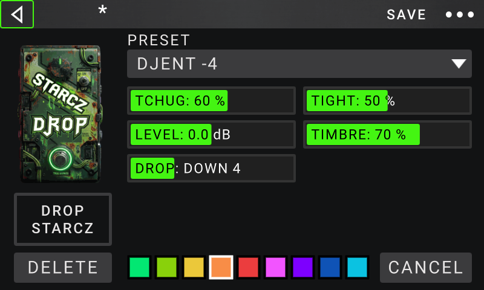 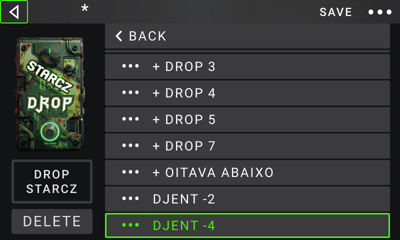

### 3. IR longo: o IR toca inteiro

De fábrica, a MX5 usa só o começo do arquivo de IR (2048 amostras = 43 ms) e joga fora o resto. Gabinetes com sala, IRs de microfone distante e reverbs perdem a cauda.

Na v9.1 o **arquivo inteiro toca (até 12 s)**: o começo continua no bloco de fábrica e a cauda é calculada à parte, no núcleo 3 do processador, sem pesar no áudio (um reverb de 4,5 s usa ~4% desse núcleo).

- Num gabinete de 1 s, a diferença para o IR completo caiu de -33 dB para -55 dB.
- Arquivos em **44,1 kHz** também funcionam.
- O **volume é nivelado sozinho**: IRs que vinham +7 a +14 dB mais altos (e estouravam) entram num nível médio, e você ajusta no botão.

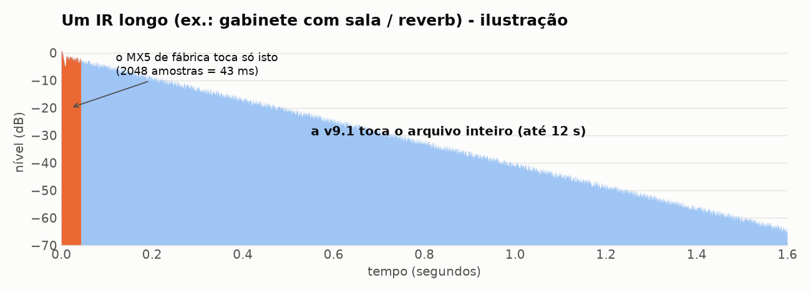

### 4. O processador usado por inteiro

A MX5 tem um processador de **4 núcleos**, mas de fábrica quase tudo roda em um só e dois ficam parados. Desde a v8 o NAM tem um núcleo só para ele; na v9.1 o último núcleo livre passou a preparar os modelos e calcular a cauda do IR.

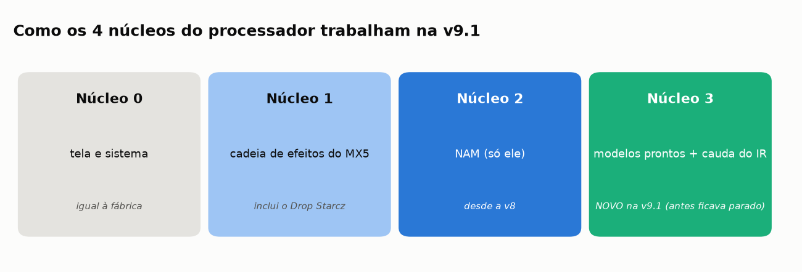

### 5. Padrões melhores para o palco

- **NAM em FULL por padrão** (o som idêntico ao NAM oficial). Rigs salvos em LITE passam a FULL.
- **Gate do NAM em -40 dB** por padrão: na v8 ele cortava o fim da nota cedo demais.
- **Atalhos no Model Selector**: NAM A2 e DROP STARCZ logo no começo, antes de Amp.

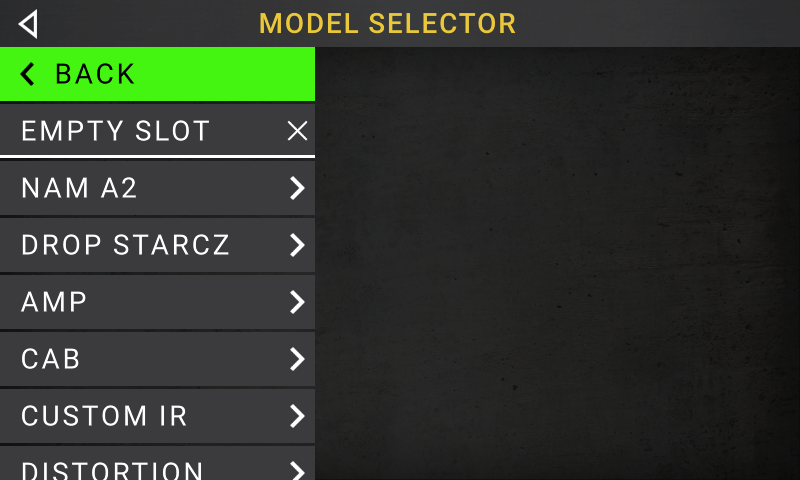 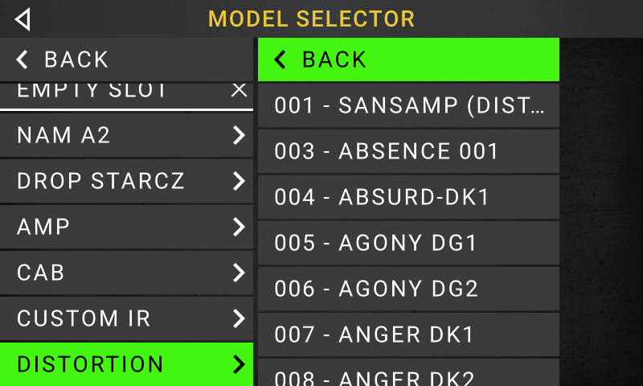

## NAM A2 Pro (no lugar do 8-Bit Crush)

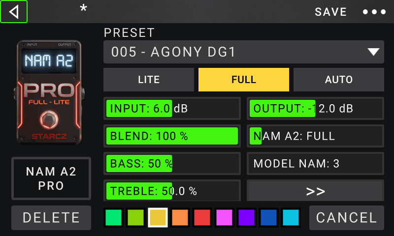 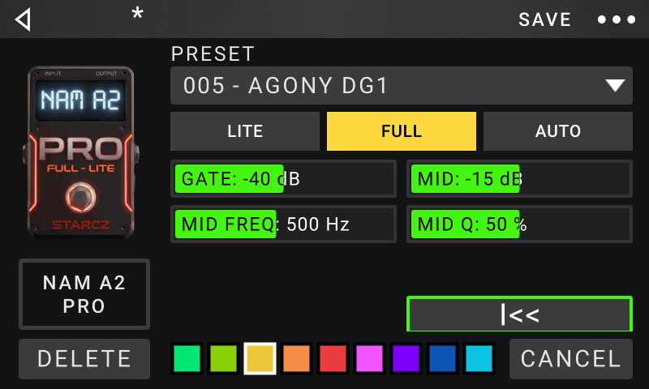

| Na tela | O que faz |
|---|---|
| **LITE / FULL / AUTO** | Tamanho do modelo. **FULL** soa idêntico ao NAM oficial; **LITE** pesa menos no processador; **AUTO** escolhe sozinho. |
| **MODEL NAM** | Escolhe o modelo. **1 clique do botão = 1 modelo.** Também dá para escolher pelo nome na lista de presets. |
| **INPUT / OUTPUT** | Ganho que entra no modelo e volume que sai. |
| **BLEND** | Mistura do baixo limpo com o NAM. 100% = só NAM. Abaixo disso, o grave limpo fica firme por baixo da distorção. |
| **BASS / TREBLE / MID / MID FREQ / MID Q** | Equalizador depois do NAM. MID Q em 0% = EQ OFF. |
| **GATE** | Corta o ruído quando você não está tocando (OFF no mínimo). |

**Como funciona o Sync:** copie os `.nam` para a pasta `NAM` do drive da MX5 e toque em **Sync**. A MX5 numera sozinha os arquivos novos (`NNN - nome`) e, de 10 a 60 segundos depois, o **aplicativo reinicia sozinho uma vez** para criar os presets e corrigir os rigs salvos. Não é travamento: não desligue.

## Como instalar (passo a passo)

1. Vá em **[Releases](../../releases/latest)** e baixe **`MX5_NAM_A2_v9.1.zip`**. Extraia.
2. Dê dois cliques em **`Instalar_MX5_NAM_A2_v9.1.exe`** (deixe a pasta `_instalador_arquivos` ao lado). Escolha o idioma e a arte (1 = Starcz, 2 = de fábrica). Ele baixa o atualizador oficial da HeadRush 2.7 e monta o firmware (uns 2 minutos). Se o Windows ou o antivírus avisar, clique em **Mais informações > Executar assim mesmo** (não há certificado pago de assinatura; o código está aqui).
3. Ligue a MX5 na tomada e no USB. Na MX5: **Global Settings > … > Firmware Update**.
4. Abra **`FirmwareUpdater.exe`** na pasta `MX5_NAM_A2_v9.1_ARTE_…_PRONTO_PARA_GRAVAR` e clique em **Instalar NAM A2 v9.1**. Não desconecte até terminar.
5. Copie os `.nam` para a pasta **`NAM`** e toque em **Sync**.
6. Editor no PC: **`MX-Edit\MX-Edit.exe`** (portátil, já com a arte).

**Vindo da v8:** é só gravar por cima. Os presets de NAM criados pela v8 continuam como estavam (AUTO e gate desligado); para usar FULL e gate em -40 dB neles, mude no pedal e salve. A v8 saiu dos downloads: a v9.1 substitui com folga.

**Para voltar ao original:** grave o atualizador oficial da HeadRush 2.7. **Se a MX5 não ligar:** segure os footswitches 1+2 ao ligar e grave o atualizador oficial.

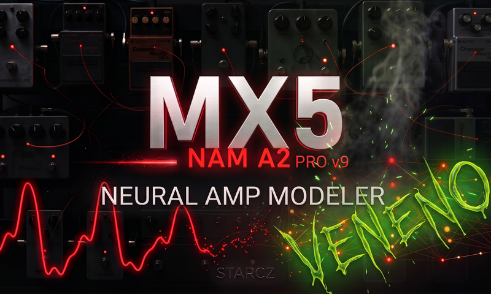

## Quão fiel é ao NAM oficial

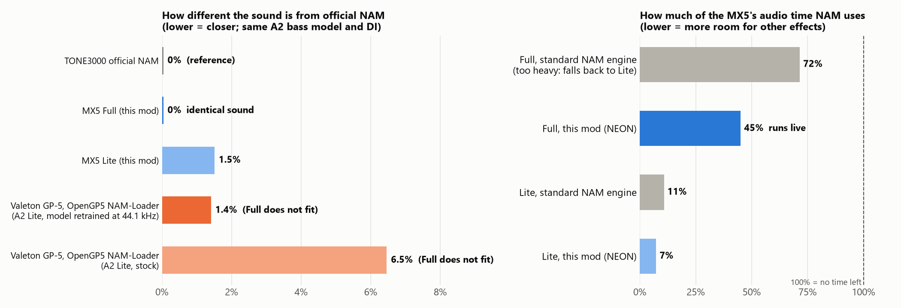

**Esquerda:** quanto o som difere do NAM oficial, com o mesmo modelo A2 de baixo (AGONY DG1) e o mesmo DI para todos. A MX5 Full é idêntica; a Lite é uma rede menor e difere um pouco. Para referência, a **Valeton GP-5** com o [NAM-Loader do OpenGP5](https://github.com/OpenGP5) (firmware aberto de terceiros) só comporta o A2 Lite: 6,5% com o loader original, 1,4% com um modelo retreinado para a taxa de 44,1 kHz dela. **Direita:** parte de cada bloco de áudio de 1 ms que o NAM ocupa na MX5. Com os motores NEON o Full ocupa 45% e roda ao vivo, num núcleo próprio; com o motor padrão do NAM ocuparia 72% e cairia para Lite. O motor do NAM é o mesmo desde a v8, então essa medição continua valendo na v9.1.

| Modelo (A2) | High (Full) x oficial | Low (Lite) x oficial |
|---|---|---|
| Tech 21 Sansamp Bass Driver 01 | resíduo -130,5 dB | -24,6 dB |
| Darkglass Fuzz - OMEGA | -134,1 dB | -26,5 dB |
| PP-DI-Only | -135,3 dB | -22,7 dB |
| B7K 6505+ Distorted Bass | -125,8 dB | -16,1 dB |

Resíduo é a energia da diferença em relação ao sinal oficial. Em **Full** o resíduo fica no arredondamento de ponto flutuante de 32 bits: é o mesmo som. Para refazer: `comparacao/run.sh`.

## Limitações conhecidas (para a próxima rodada)

- No **Hardware Assign**, o NAM A2 Pro ainda aparece como "8-Bit Crush" (o Drop Starcz já aparece certo).
- Na tela do NAM A2 Pro, INPUT, OUTPUT e MID mostram o número interno do pedal (por exemplo, MID -15 dB = neutro).
- O Drop Starcz ainda dá uma pipocada esporádica em notas longas na corda mais grave.
- Girar rápido o TIMBRE do Drop Starcz faz um leve ruído durante o movimento; o Gain do IR também faz, mas esse já vem do firmware de fábrica.
- IR estéreo, o IR2 e o IR do mixer continuam como de fábrica.

## Próximas ideias

- **Synth para baixo.**
- Melhorar os outros pedais, do mesmo jeito que o drop e o IR.

## Caminho até aqui

1. **Base.** NAM do lolgab (2 instâncias) e MX5 Bridge 0.7 para usar o MX-Edit no PC. O build do lolgab foi reproduzido byte a byte antes de qualquer mudança.
2. **v1, motores A2.** Port dos motores A2 Lite/Full da tone-3000/embedded para ARMv7 NEON, com seleção automática no aparelho.
3. **v2, uso ao vivo.** Chave Lite/Full, colapso mono, carregamento fora do caminho do áudio, medidor em `/tmp/nam_a2_stats.txt`.
4. **v3 a v6.** Presets por modelo e sincronização automática (`nam-sync.sh`), rigs que se corrigem sozinhos, descarte de `.nam` com defeito.
5. **v7.** Arte própria dos pedais, amps e gabinetes, nova tela de abertura, atalho NAM A2 no Model Selector, instalador com arte Starcz ou de fábrica.
6. **v8.** NAM A2 Pro no 8-Bit Crush com controles para baixo; NAM num núcleo próprio; instalador em três idiomas.
7. **v9 / v9.1.** Troca de modelo sem silêncio (modelos prontos no núcleo 3), Drop Starcz no lugar do Panner com TCHUG e TIGHT, IR longo com FFTConvolver no núcleo 3, FULL e gate -40 dB por padrão, nova abertura e ícones de IR.

## Estrutura

| Pasta | Conteúdo |
|---|---|
| `motor/` | Motor: patches sobre o lolgab, motores A2 (`t3k_a2.cpp`, `nam_armv7_neon.h`), scripts de build e testes. v8: `v8_nucleos.py`, `v8_pro.py`. v9: `v81_troca.py` e `v82_reserva.py` (troca sem silêncio), `drop_tune.h` + `v83_drop.py` (Drop Starcz), `v84_ir.py` + `v84_cauda.inc` + `fftconvolver/` (IR longo), `v9_ajustes.py` (padrões). v9.1: `v91_panner.py` + `v91_tchug.inc` (Drop Starcz no Panner, TCHUG e TIGHT), `v91_build.sh` |
| `firmware/v3` a `v91` | `nam-sync.sh` e os scripts que montam a imagem de cada versão, com os testes (126 conferências na v9.1) |
| `ferramentas/` | Ferramentas que falam com o aparelho pela Bridge |
| `comparacao/` | Comparação com o NeuralAmpModelerCore oficial e os gráficos (`grafico.py`, `figuras_v91.py`) |
| `instalador/` | Instalador: `instalar.py` aplica o `payload/` sobre o firmware oficial; `dev/make_payload.py` gera o `payload/`; `bridge/` traz as bibliotecas da MX5 Bridge 0.7 (MIT) |
| `docs/` | Imagens desta página (telas capturadas direto da MX5 em `docs/v91/`) |

## Como montar

Ambiente usado: WSL Ubuntu 24.04, toolchain Bootlin `arm-buildroot-linux-gnueabihf` (glibc 2.31) em `/opt/toolchain`, `qemu-arm`, Python 3.12.

1. `motor/01_setup.sh` a `06_build.sh` baixam as fontes, reproduzem o build do lolgab, aplicam os patches e geram o `libnam_hook.so`. Para a v9.1, `motor/v91_build.sh` aplica por cima todos os passos da v8 à v9.1.
2. `firmware/v91/gen_build_v91.py` gera o `build_v91.py`, que monta a imagem a partir da v6 e roda os testes.
3. O `Update.img` original 2.7 você fornece. Os scripts têm caminhos da minha máquina; ajuste.

## Fontes e créditos

- [lolgab/headrush-nam-mod](https://github.com/lolgab/headrush-nam-mod): o mod de NAM para HeadRush em que este se baseia (GPLv3).
- [tone-3000/embedded](https://github.com/tone-3000/embedded) 2.0.0: motores A2 Lite/Full (MIT).
- [sdatkinson/NeuralAmpModelerCore](https://github.com/sdatkinson/NeuralAmpModelerCore): implementação de referência do NAM (MIT).
- [HiFi-LoFi/FFTConvolver](https://github.com/HiFi-LoFi/FFTConvolver): convolução por partições usada no IR longo (MIT).
- MX5 Bridge 0.7 e MX-Edit, do TicT4x: acesso USB-MIDI ao aparelho e editor de PC (MIT). Editor atual: [fork do MX-Edit](https://github.com/pagueobaixista-afk/MX-Edit).
- [SiulGalvan/Forge-Patch](https://github.com/SiulGalvan/Forge-Patch): pacote que integrou NAM e Bridge; foi a base da imagem com a Bridge (GPLv3).
- [iosumurillo/GIGBOARD_NAM_AMP_PNG](https://github.com/iosumurillo/GIGBOARD_NAM_AMP_PNG): mostrou como trocar as imagens dos pedais na tela (GPLv3).
- [Eigen](https://eigen.tuxfamily.org) e [nlohmann/json](https://github.com/nlohmann/json), dependências do NAM. Toolchains da [Bootlin](https://toolchains.bootlin.com).

**Arte dos pedais:** a opção 1 do instalador é arte original feita para este mod (Starcz), incluindo o Drop Starcz. A opção 2 usa as imagens de fábrica, tiradas na hora da instalação do firmware oficial no seu próprio PC; elas não vão neste pacote.

HeadRush e MX5 são marcas da inMusic; este projeto não tem vínculo com o fabricante.

## Licença

GPLv3, por derivar do headrush-nam-mod. Ver `LICENSE`.

## Apoie o projeto

Este mod é feito nas horas livres, com testes de verdade em ensaio e palco, e com a ajuda de uma IA paga (Claude Fable 5.2). Cada versão leva muitas horas e gasta bastante dinheiro em uso da IA. Se o mod te ajudou e você quiser apoiar as próximas inovações (synth para baixo, pedais melhores), qualquer valor ajuda.

| Rede | Moedas | Endereço |
|---|---|---|
| **EVM**: Ethereum, BNB Smart Chain, Base, Arbitrum One, Optimism, Polygon PoS, Avalanche C-Chain | ETH, BNB, POL, AVAX, USDC, USDT | `0x8dbd2Cbc766bD97Cd256d6778b604a19b2Ea461d` |
| **Solana** | SOL, USDC, USDT (SPL) | `3PgJBYaCo3Ld3QAAksGwSnF2eEbF3n7SBtWyDEdz33NN` |
| **TRON** | TRX, USDT (TRC-20) | `TL27vn9EFPSqyFDM9uUPNapDncqMBeVqfb` |
| **Bitcoin** (Native SegWit) | BTC | `bc1q4q3x9jr53sk2p95q8y466g24cxccxcw9mctgm3` |
| **Litecoin** (Native SegWit) | LTC | `ltc1q37rv4ue87myv29p8psk6ckrjpxjlpcln5gk35v` |

Confira a rede antes de enviar: moeda mandada pela rede errada pode se perder. Exploradores: [Etherscan](https://etherscan.io/address/0x8dbd2Cbc766bD97Cd256d6778b604a19b2Ea461d) · [BscScan](https://bscscan.com/address/0x8dbd2Cbc766bD97Cd256d6778b604a19b2Ea461d) · [BaseScan](https://basescan.org/address/0x8dbd2Cbc766bD97Cd256d6778b604a19b2Ea461d) · [Arbiscan](https://arbiscan.io/address/0x8dbd2Cbc766bD97Cd256d6778b604a19b2Ea461d) · [PolygonScan](https://polygonscan.com/address/0x8dbd2Cbc766bD97Cd256d6778b604a19b2Ea461d) · [Solscan](https://solscan.io/account/3PgJBYaCo3Ld3QAAksGwSnF2eEbF3n7SBtWyDEdz33NN) · [TronScan](https://tronscan.org/#/address/TL27vn9EFPSqyFDM9uUPNapDncqMBeVqfb) · [Mempool](https://mempool.space/address/bc1q4q3x9jr53sk2p95q8y466g24cxccxcw9mctgm3) · [Blockchair](https://blockchair.com/litecoin/address/ltc1q37rv4ue87myv29p8psk6ckrjpxjlpcln5gk35v)

Obrigado! 🤘
