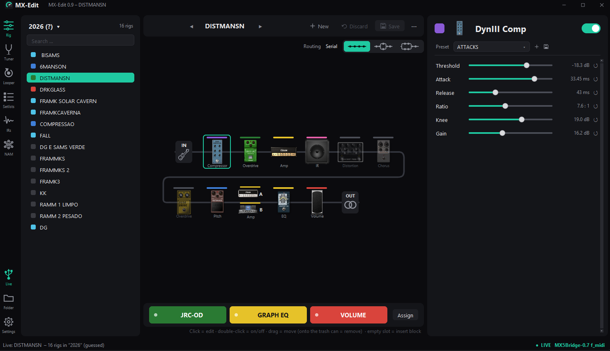
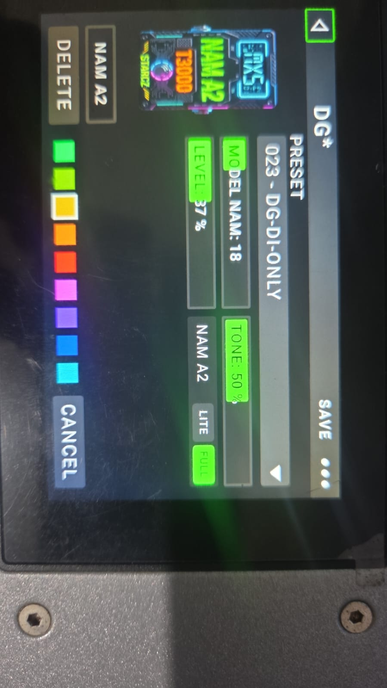

# HeadRush MX5 NAM A2 Full/Lite

[English](README.md) | **Português** | [Español](README.es.md)

Firmware personalizado para o **HeadRush MX5 (2.7)** que roda modelos **NAM (Neural Amp Modeler)**, incluindo os modelos **A2** no tamanho completo, com uma lista de modelos que se mantém sozinha.

É um trabalho derivado de [lolgab/headrush-nam-mod](https://github.com/lolgab/headrush-nam-mod) (v0.1.6), com os motores A2 de [tone-3000/embedded](https://github.com/tone-3000/embedded) portados para ARMv7 NEON e a [MX5 Bridge](#fontes-e-créditos) para acesso ao aparelho pelo PC.

Projeto desenvolvido e compilado com o **Claude Fable 5.2** (Anthropic).

*O mesmo rig no MX-Edit, no PC, com a imagem de cada pedal, e na tela do MX5 (com o pedal NAM A2).*

**Editor de PC:** [HeadRush MX5 PC Editor (fork do MX-Edit)](https://github.com/pagueobaixista-afk/MX-Edit) – conecta ao MX5 na hora no Windows 11 e mostra a imagem de cada pedal. O instalador deste projeto já traz o editor.

> **Aviso.** Firmware não oficial, sem vínculo com a HeadRush/inMusic. Gravar firmware modificado é por sua conta e risco e pode anular a garantia; os autores não se responsabilizam por danos. O repositório e o instalador **não** contêm o firmware nem o atualizador da HeadRush: o instalador parte do atualizador oficial, baixado do site da inMusic na hora. Recuperação do MX5: footswitches 1+2 ao ligar e gravar o atualizador oficial 2.7 (2+3 apaga os rigs).

## 🎬 Vídeos

- **Demonstração (v7):** [NAM A2 Full/Lite tocando na HeadRush MX5](https://youtu.be/nuovUCALZjI): abertura, menu NAM A2 e a chave Lite/Full.
- **Como instalar:** [vídeo passo a passo](https://youtu.be/1Bj1k44fe2Y) (gravado com a v6; a v7 instala do mesmo jeito e só acrescenta a pergunta da arte).

## Novidades da v7

- **NAM A2 com nome e menu próprios.** O pedal aparece como **NAM A2** em toda a tela, e o Model Selector ganhou o botão **NAM A2** (entre Empty Slot e Amp), que abre direto a lista de modelos NAM.
- **Tela do pedal feita para o NAM:** o Drive aparece como **MODEL NAM: N** (número do modelo) e a chave Hi-Lo como **NAM A2 LITE / FULL**.
- **Duas opções de arte, escolhidas no instalador:**
  1. **Arte Starcz** (recomendada): imagens novas de pedais, amps e gabinetes e nova tela de abertura, desenhadas para o mod.
  2. **Arte de fábrica:** as imagens e a abertura originais da HeadRush (tiradas do firmware oficial no seu PC; não vão neste projeto).
- Crédito em Global Settings (abaixo do aviso da inMusic, que continua igual).
- Motor NAM, som e `nam-sync.sh` iguais aos da v6. Por dentro o pedal continua "Anxiety OD", então rigs, presets e o editor de PC continuam funcionando.

## Como instalar (passo a passo)

1. Entre em **[Releases](../../releases/latest)** e baixe o arquivo **`MX5_NAM_A2_v7.zip`**.
2. Clique com o botão direito no zip > **Extrair tudo**.
3. Na pasta extraída, dê dois cliques em **`Instalar_MX5_NAM_A2_v7.exe`**.
   - Ele pergunta qual arte você quer: digite **1** (arte Starcz) ou **2** (arte de fábrica) e aperte Enter.
   - Ele baixa o atualizador oficial da HeadRush 2.7, monta o firmware e confere tudo (uns 2 minutos).
   - Se o Windows avisar "O Windows protegeu o computador", clique em **Mais informações > Executar assim mesmo** (o programa não tem assinatura digital paga).
   - Sem internet: arraste o atualizador oficial que você já tem para cima do `.exe`.
4. Vai aparecer a pasta **`MX5_NAM_A2_v7_ARTE_STARCZ_PRONTO_PARA_GRAVAR`** (ou `..._ARTE_ORIGINAL_...`).
5. Ligue o MX5 na tomada e no PC pelo USB. No MX5: **Global Settings > … > Firmware Update**.
6. Abra **`FirmwareUpdater.exe`** dessa pasta e clique em **Instalar NAM A2 v7**. Não desconecte até terminar.
7. Copie seus `.nam` para a pasta **`NAM`** do drive do MX5, ejete e toque em **Sync**. Os modelos aparecem como presets do pedal **NAM A2** (Model Selector > **NAM A2**).
8. Para editar no PC, abra **`MX-Edit\MX-Edit.exe`** (feche antes outro MX-Edit que estiver aberto). O instalador coloca em `MX-Edit\arte` as mesmas imagens de pedal, amplificador e gabinete que o MX5 mostra na tela.

**Para voltar ao original:** grave o atualizador oficial da HeadRush 2.7 do mesmo jeito. **Para trocar de arte:** rode o instalador de novo, escolha a outra opção e grave. Quem está na v6 pode gravar a v7 direto; rigs e pasta NAM continuam.

## O que faz

- **NAM dentro do pedal Anxiety OD.** O knob Drive escolhe o modelo (posição na pasta `NAM`), Tone é o ganho de entrada e Level o de saída.
- **A2 Lite e Full pela chave Hi-Lo.** Low = submodelo reduzido (Lite), High = modelo completo (Full). Dá para virar tocando.
- **Motores A2 mais rápidos.** Os motores `t3k` portados para NEON são escolhidos por medição no próprio aparelho. Medido no MX5: Full de 715 µs para 451 µs por bloco de 48 amostras (1,58×), Lite de 108 para 73 µs. O bloco dura 1000 µs.
- **Menos carga à toa.** Sinal mono (L igual a R) é processado uma vez só; a contagem de instâncias ativas foi corrigida; as threads de carga de modelo ficam fora do núcleo e da prioridade do áudio.
- **Lista de modelos como um carregador de IR.** Cada `.nam` vira um preset `NNN - nome` do Anxiety OD.
- **Sincronização automática** (`nam-sync.sh`), na partida e ao sair da transferência USB (Sync):
  - numera os `.nam` novos com o próximo número livre, para as posições antigas não mudarem;
  - valida os arquivos e move os defeituosos para `NAM/_com_defeito`;
  - cria, atualiza e remove os presets;
  - corrige o Drive nos rigs salvos se um modelo mudar de posição (com cópia do banco antes);
  - calcula o Level do preset pelo `metadata.loudness` do modelo (opcional, ver abaixo);
  - reinicia o aplicativo sozinho quando a lista mudou e grava um relatório em `NAM/nam_sync_relatorio.txt`.

Arquivos de controle na pasta `NAM`: `nam_config.txt` (`quality=switch|lite|full|auto`), `nam_sync.txt` (`alvo=`, `nivelar=0`), `nam_sync_off.txt`, `nam_restart_off.txt`.

**Sobre o nivelamento de volume:** ele iguala o volume percebido, mas muda o quanto o modelo empurra os blocos seguintes do rig, e alguns acabam saturando. Na prática o Level precisa de ajuste manual por rig; use `nivelar=0` se preferir todos em 50.

## Quão fiel é ao NAM oficial

Comparação direta: o mesmo áudio (2 s do sinal de teste do NeuralAmpModelerCore + 10 s de baixo gravado em linha, 48 kHz) passou pelo [NeuralAmpModelerCore](https://github.com/sdatkinson/NeuralAmpModelerCore) oficial compilado no PC e pelo `libnam_hook.so` idêntico ao do aparelho (mesmo SHA1), rodando em `qemu-arm` com as bibliotecas do firmware, motor `t3k-mla`, Tone e Level em 0 dB.

| Modelo (A2) | High (Full) x oficial | Low (Lite) x oficial |
|---|---|---|
| Tech 21 Sansamp Bass Driver 01 | resíduo -130,5 dB | -24,6 dB |
| Darkglass Fuzz - OMEGA | -134,1 dB | -26,5 dB |
| PP-DI-Only | -135,3 dB | -22,7 dB |
| B7K 6505+ Distorted Bass | -125,8 dB | -16,1 dB |

Resíduo é a energia da diferença em relação ao sinal oficial. Em **Full** não há atraso nem diferença de nível, e o resíduo fica no arredondamento de ponto flutuante de 32 bits: é o mesmo som. Em **Lite** roda o submodelo reduzido que vem dentro do próprio `.nam`, uma rede menor, e a diferença é audível nos modelos de mais ganho.

O que essa medição não cobre: os conversores e o estágio de entrada do MX5, e o que vem antes e depois do NAM no rig. Para refazer: `comparacao/run.sh`.

## Caminho até aqui

1. **Base.** NAM do lolgab (2 instâncias) e a MX5 Bridge 0.7 para usar o MX-Edit no PC. O build do lolgab foi reproduzido byte a byte antes de qualquer mudança.
2. **v1, motores A2.** Port dos motores A2 Lite/Full de tone-3000/embedded para ARMv7 NEON (variantes `fma` e `mla`), com seleção automática no aparelho e relatório em `/tmp/nam_a2_report.txt`. Testado em qemu-arm e depois medido no MX5.
3. **v2, usada em show.** Chave Hi-Lo como seletor Lite/Full (byte achado por diferença de memória, `memscan.c` e `hilo_probe.py`), colapso mono, contagem de instâncias, threads de carga fora do áudio, medidor `/tmp/nam_a2_stats.txt`. Um show inteiro sem nenhum estouro de bloco.
4. **Presets por modelo.** Presets do Anxiety OD gravados no banco SQLite do aparelho pela Bridge (`ferramentas/nam_presets.py`).
5. **v3.** Sincronização na partida (`nam-sync.sh`, chamado no `runevil`).
6. **v4.** Sincronização também ao sair da transferência USB (`mount_usb_img`) e reinício automático do aplicativo.
7. **v5.** Rigs que se corrigem, nivelamento por loudness, descarte de `.nam` com defeito, relatório.
8. **v6.** Correção: o aplicativo regrava o banco a partir da memória ao terminar o próprio Sync e apagava os presets recém-criados. Agora o banco só é alterado depois que o aplicativo termina (modo `deferred`), e então ele é reiniciado.

Descartado no caminho: reler a pasta sem reiniciar o aplicativo (risco no áudio) e trocar o Anxiety OD por outro pedal.

## Estrutura

| Pasta | Conteúdo |
|---|---|
| `motor/` | Patches sobre o lolgab (`nam_hook.diff`, `model_cpp.diff`), motores (`t3k_a2.cpp`, `nam_armv7_neon.h`), scripts de build e teste numerados, `harness.c`, cliente da Bridge (`brq.py`) |
| `firmware/v3` a `v6` | `nam-sync.sh` de cada versão, scripts que montam a imagem (`build_vN.py`) e a checagem do sistema de arquivos |
| `ferramentas/` | Sincronização de presets pelo PC, via Bridge |
| `comparacao/` | Comparação com o NeuralAmpModelerCore oficial |
| `editor/` | Patch sobre o [MX-Edit](https://github.com/TicT4x/MX-Edit) 0.9.5 (TicT4x, MIT): arte real dos blocos (PNG de `arte/`, mesma regra de nomes do QML do MX5) e conexão confiável (pausa de 0,3 s depois de abrir a porta MIDI: sem ela o 1º ping se perdia 8 de 8 vezes; novas tentativas; procura o MX5 sozinho até achar) |
| `instalador/` | Instalador para leigos: `instalar.py` aplica `payload/` (arquivos novos, só as linhas alteradas dos scripts da HeadRush e 38 bytes do `/usr/Evil/Evil`) ao firmware oficial; `dev/make_payload.py` gera o `payload/` a partir da v6; `bridge/` são as bibliotecas da MX5 Bridge 0.7 (MIT) |

## Como montar

Ambiente usado: WSL Ubuntu 24.04, toolchain Bootlin `arm-buildroot-linux-gnueabihf` (glibc 2.31) em `/opt/toolchain`, `qemu-arm`, Python 3.12.

1. `motor/01_setup.sh` a `06_build.sh` baixam as fontes, reproduzem o build do lolgab, aplicam os patches e geram o `libnam_hook.so`. `07_test.sh` em diante são os testes.
2. `motor/build_a2.py` insere o motor numa imagem base já com a Bridge. `firmware/vN/build_vN.py` aplica cada versão sobre a anterior e roda os testes de montagem.
3. É preciso fornecer por conta própria o `Update.img` 2.7 original e o patcher da MX5 Bridge 0.7. Os scripts trazem caminhos da minha máquina; ajuste-os.

## Fontes e créditos

- [lolgab/headrush-nam-mod](https://github.com/lolgab/headrush-nam-mod): o mod de NAM para HeadRush que serve de base (GPLv3).
- [tone-3000/embedded](https://github.com/tone-3000/embedded) 2.0.0: motores A2 Lite/Full (MIT).
- [sdatkinson/NeuralAmpModelerCore](https://github.com/sdatkinson/NeuralAmpModelerCore): implementação de referência do NAM (MIT).
- MX5 Bridge 0.7 e MX-Edit 0.9.5, de TicT4x: acesso ao aparelho por USB-MIDI e editor de PC (MIT).
- [SiulGalvan/Forge-Patch](https://github.com/SiulGalvan/Forge-Patch) ("HEADRUSH MX5 Compatibility Layer"): pacote que integra NAM, Bridge e arte; foi a base da imagem com Bridge (GPLv3).
- [iosumurillo/GIGBOARD_NAM_AMP_PNG](https://github.com/iosumurillo/GIGBOARD_NAM_AMP_PNG): patch de arte dos pedais na tela (GPLv3).
- [Eigen](https://eigen.tuxfamily.org) e [nlohmann/json](https://github.com/nlohmann/json), dependências do NAM.
- Toolchains da [Bootlin](https://toolchains.bootlin.com).

**Arte dos pedais:** as imagens dos pedais são material da HeadRush (inMusic), integradas pelo iosumurillo e pelo Forge-Patch. Elas não fazem parte deste repositório: vão à parte, no arquivo `arte_pedais.bin` do zip da Release, só para uso no MX5 do próprio usuário. Sem esse arquivo, o instalador monta o firmware sem a arte. Detentores de direitos que quiserem a remoção podem abrir uma issue; o arquivo é retirado imediatamente.

HeadRush e MX5 são marcas da inMusic; este projeto não tem vínculo com a fabricante.

## Licença

GPLv3, por derivar do headrush-nam-mod. Ver `LICENSE`.
