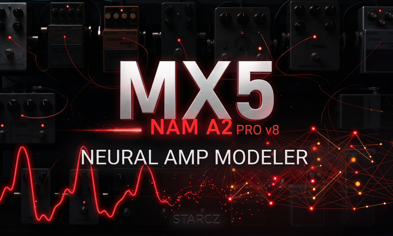

# HeadRush MX5 NAM A2 Pro (Full/Lite)

[English](README.md) | **Português** | [Español](README.es.md)

Firmware personalizado para o **HeadRush MX5 (2.7)** que roda modelos **NAM (Neural Amp Modeler)**, incluindo os modelos **A2** no tamanho completo, com uma lista de modelos que se mantém sozinha.

É um trabalho derivado de [lolgab/headrush-nam-mod](https://github.com/lolgab/headrush-nam-mod) (v0.1.6), com os motores A2 de [tone-3000/embedded](https://github.com/tone-3000/embedded) portados para ARMv7 NEON e a [MX5 Bridge](#fontes-e-créditos) para acesso ao aparelho pelo PC.

Projeto desenvolvido e compilado com o **Claude Fable 5.2** (Anthropic).

*O mesmo rig no MX-Edit, no PC, com a imagem de cada pedal, e na tela do MX5 (com o pedal NAM A2).*

**Editor de PC:** [HeadRush MX5 PC Editor (fork do MX-Edit)](https://github.com/pagueobaixista-afk/MX-Edit) – conecta ao MX5 na hora no Windows 11 e mostra a imagem de cada pedal. O instalador deste projeto já traz o editor.

> **Aviso.** Firmware não oficial, sem vínculo com a HeadRush/inMusic. Gravar firmware modificado é por sua conta e risco e pode anular a garantia; os autores não se responsabilizam por danos. O repositório e o instalador **não** contêm o firmware nem o atualizador da HeadRush: o instalador parte do atualizador oficial, baixado do site da inMusic na hora. Recuperação do MX5: footswitches 1+2 ao ligar e gravar o atualizador oficial 2.7 (2+3 apaga os rigs).

## 🎬 Vídeos

- **Demonstração (v7):** [NAM A2 Full/Lite tocando na HeadRush MX5](https://youtu.be/nuovUCALZjI): abertura, menu NAM A2 e a chave Lite/Full.
- **Como instalar:** [vídeo passo a passo](https://youtu.be/1Bj1k44fe2Y) (gravado com a v6; a v7 instala do mesmo jeito e só acrescenta a pergunta da arte).

## Novidades da v8: NAM A2 Pro

**Feito por um baixista.** A v8 tira o NAM do Anxiety OD e o coloca num pedal com botões suficientes: o **8-Bit Crush** vira o **NAM A2 Pro**. Os controles foram escolhidos pensando no baixo: um blend que mantém o grave limpo e firme por baixo da distorção, um EQ com faixas úteis para baixo e um gate para os modelos com mais ganho.

**Os controles do NAM A2 Pro, em palavras simples:**

| Na tela | O que faz |
|---|---|
| **NAM LITE / FULL / AUTO** | Tamanho do modelo. **FULL** soa idêntico ao NAM oficial; **LITE** pesa menos no processador; **AUTO** escolhe sozinho. |
| **MODEL NAM** | Escolhe o modelo. **1 clique do botão = 1 modelo.** Também dá para escolher pelo nome na lista de presets. |
| **INPUT** | Quanto sinal entra no modelo: mais = mais saturação, como o ganho de um amplificador. 50% = 0 dB. |
| **OUTPUT** | Volume de saída, sem mudar o timbre. 50% = 0 dB. |
| **BLEND** | Mistura do baixo limpo com o NAM. 100% = só NAM. Abaixo disso, o grave limpo fica por baixo da distorção, como nos pedais de drive para baixo. |
| **BASS / TREBLE** | Grave e agudo depois do NAM. 50% = sem mudança. |
| **MID / MID FREQ / MID Q** | Um médio ajustável. MID em 0 dB = sem mudança. |
| **GATE** | Corta o ruído quando você não está tocando. No mínimo, fica desligado. |

**Para desligar o EQ:** ele se desliga sozinho na posição neutra (BASS e TREBLE em 50%, MID em 0 dB), e **MID Q em 0% mostra EQ OFF** e tira o EQ inteiro de uma vez.

**Também na v8**

- **NAM num núcleo próprio do processador.** A MX5 tem 4 núcleos e o áudio roda em um; agora o NAM roda num núcleo livre (+1 ms de atraso), deixando espaço para os outros efeitos. O carregamento dos modelos também saiu do núcleo do áudio: a troca de rig ficou mais rápida e mais limpa.
- **Presets pelo nome, neutros.** Cada `.nam` vira um preset do NAM A2 Pro com tudo neutro (sem nivelamento automático de volume; você ajusta). Os presets de fábrica do 8-Bit Crush são removidos, porque não fazem sentido para o NAM.
- **Nova tela de abertura** e arte nova para vários pedais.
- **Instalador em português, inglês e espanhol**, e o editor **MX-Edit** vai **portátil**, já com a arte.
- **O Anxiety OD voltou a ser o pedal original.** Rigs da v7 que usavam o NAM dentro do Anxiety OD precisam ser refeitos com o NAM A2 Pro.

**Como funciona o Sync:** copie os `.nam` para a pasta `NAM` do drive da MX5 e toque em **Sync**. A MX5 numera sozinha os arquivos novos (`NNN - nome`) e, de 10 a 60 segundos depois, o **aplicativo reinicia sozinho uma vez** para criar os presets e corrigir os rigs salvos. Não é travamento: não desligue. Se você só copiar os arquivos e ligar a MX5, tudo acontece durante a partida. O número mantém a ordem fixa: modelos novos vão para o fim e nada do que você já tem muda de lugar.

## Como instalar (passo a passo)

1. Vá em **[Releases](../../releases/latest)** e baixe **`MX5_NAM_A2_v8.zip`**. Extraia.
2. Dê dois cliques em **`Instalar_MX5_NAM_A2_v8.exe`** (deixe a pasta `_instalador_arquivos` ao lado). Escolha o idioma e a arte (1 = Starcz, 2 = de fábrica). Ele baixa o atualizador oficial da HeadRush 2.7 e monta o firmware (uns 2 minutos). Se o Windows ou o antivírus avisar, clique em **Mais informações > Executar assim mesmo** (não há certificado pago de assinatura; o código está aqui).
3. Ligue a MX5 na tomada e no USB. Na MX5: **Global Settings > … > Firmware Update**.
4. Abra **`FirmwareUpdater.exe`** na pasta `MX5_NAM_A2_v8_ARTE_…_PRONTO_PARA_GRAVAR` e clique em **Instalar NAM A2 v8**. Não desconecte até terminar.
5. Copie os `.nam` para a pasta **`NAM`** e toque em **Sync** (veja acima). Na MX5: **Model Selector > NAM A2**.
6. Editor no PC: **`MX-Edit\MX-Edit.exe`** (portátil, já com a arte).

**Para voltar ao original:** grave o atualizador oficial da HeadRush 2.7. **Se a MX5 não ligar:** segure os footswitches 1+2 ao ligar e grave o atualizador oficial.

## Quão fiel é ao NAM oficial

**Esquerda:** quanto o som difere do NAM oficial, com o mesmo modelo A2 de baixo (AGONY DG1) e o mesmo DI para todos. A MX5 Full é idêntica; a Lite é uma rede menor e difere um pouco. Para referência, a **Valeton GP-5** com o [NAM-Loader do OpenGP5](https://github.com/OpenGP5) (firmware aberto de terceiros) só comporta o A2 Lite (o Full não cabe no processador dela): 6,5% com o loader original, 1,4% com um modelo retreinado para a taxa de 44,1 kHz dela. **Direita:** parte de cada bloco de áudio de 1 ms que o NAM ocupa na MX5. Com os motores NEON o Full ocupa 45% e roda ao vivo (na v8, num núcleo próprio); com o motor padrão do NAM ocuparia 72% e cairia para Lite.

Comparação direta: o mesmo áudio (2 s do sinal de teste do NeuralAmpModelerCore + 10 s de baixo gravado em linha, 48 kHz) passou pelo [NeuralAmpModelerCore](https://github.com/sdatkinson/NeuralAmpModelerCore) oficial compilado no PC e pelo `libnam_hook.so` idêntico ao do aparelho (mesmo SHA1), rodando em `qemu-arm` com as bibliotecas do firmware, motor `t3k-mla`, Tone e Level em 0 dB.

| Modelo (A2) | High (Full) x oficial | Low (Lite) x oficial |
|---|---|---|
| Tech 21 Sansamp Bass Driver 01 | resíduo -130,5 dB | -24,6 dB |
| Darkglass Fuzz - OMEGA | -134,1 dB | -26,5 dB |
| PP-DI-Only | -135,3 dB | -22,7 dB |
| B7K 6505+ Distorted Bass | -125,8 dB | -16,1 dB |

Resíduo é a energia da diferença em relação ao sinal oficial. Em **Full** não há atraso nem diferença de nível, e o resíduo fica no arredondamento de ponto flutuante de 32 bits: é o mesmo som. Em **Lite** roda o submodelo reduzido que vem dentro do próprio `.nam`, uma rede menor, e a diferença é audível nos modelos de mais ganho.

O que essa medição não cobre: os conversores e o estágio de entrada do MX5, e o que vem antes e depois do NAM no rig. Para refazer: `comparacao/run.sh`.

## Caminho até aqui

1. **Base.** NAM do lolgab (2 instâncias) e a MX5 Bridge 0.7 para usar o MX-Edit no PC. O build do lolgab foi reproduzido byte a byte antes de qualquer mudança.
2. **v1, motores A2.** Port dos motores A2 Lite/Full de tone-3000/embedded para ARMv7 NEON (variantes `fma` e `mla`), com seleção automática no aparelho e relatório em `/tmp/nam_a2_report.txt`. Testado em qemu-arm e depois medido no MX5.
3. **v2, usada em show.** Chave Hi-Lo como seletor Lite/Full (byte achado por diferença de memória, `memscan.c` e `hilo_probe.py`), colapso mono, contagem de instâncias, threads de carga fora do áudio, medidor `/tmp/nam_a2_stats.txt`. Um show inteiro sem nenhum estouro de bloco.
4. **Presets por modelo.** Presets do Anxiety OD gravados no banco SQLite do aparelho pela Bridge (`ferramentas/nam_presets.py`).
5. **v3.** Sincronização na partida (`nam-sync.sh`, chamado no `runevil`).
6. **v4.** Sincronização também ao sair da transferência USB (`mount_usb_img`) e reinício automático do aplicativo.
7. **v5.** Rigs que se corrigem, nivelamento por loudness, descarte de `.nam` com defeito, relatório.
8. **v6.** Correção: o aplicativo regrava o banco a partir da memória ao terminar o próprio Sync e apagava os presets recém-criados. Agora o banco só é alterado depois que o aplicativo termina (modo `deferred`), e então ele é reiniciado.

Descartado no caminho: reler a pasta sem reiniciar o aplicativo (risco no áudio) e trocar o Anxiety OD por outro pedal.

## Estrutura

| Pasta | Conteúdo |
|---|---|
| `motor/` | Patches sobre o lolgab (`nam_hook.diff`, `model_cpp.diff`), motores (`t3k_a2.cpp`, `nam_armv7_neon.h`), scripts de build e teste numerados, `harness.c`, cliente da Bridge (`brq.py`) |
| `firmware/v3` a `v6` | `nam-sync.sh` de cada versão, scripts que montam a imagem (`build_vN.py`) e a checagem do sistema de arquivos |
| `ferramentas/` | Sincronização de presets pelo PC, via Bridge |
| `comparacao/` | Comparação com o NeuralAmpModelerCore oficial |
| `editor/` | Patch sobre o [MX-Edit](https://github.com/TicT4x/MX-Edit) 0.9.5 (TicT4x, MIT): arte real dos blocos (PNG de `arte/`, mesma regra de nomes do QML do MX5) e conexão confiável (pausa de 0,3 s depois de abrir a porta MIDI: sem ela o 1º ping se perdia 8 de 8 vezes; novas tentativas; procura o MX5 sozinho até achar) |
| `instalador/` | Instalador para leigos: `instalar.py` aplica `payload/` (arquivos novos, só as linhas alteradas dos scripts da HeadRush e 38 bytes do `/usr/Evil/Evil`) ao firmware oficial; `dev/make_payload.py` gera o `payload/` a partir da v6; `bridge/` são as bibliotecas da MX5 Bridge 0.7 (MIT) |

## Como montar

Ambiente usado: WSL Ubuntu 24.04, toolchain Bootlin `arm-buildroot-linux-gnueabihf` (glibc 2.31) em `/opt/toolchain`, `qemu-arm`, Python 3.12.

1. `motor/01_setup.sh` a `06_build.sh` baixam as fontes, reproduzem o build do lolgab, aplicam os patches e geram o `libnam_hook.so`. `07_test.sh` em diante são os testes.
2. `motor/build_a2.py` insere o motor numa imagem base já com a Bridge. `firmware/vN/build_vN.py` aplica cada versão sobre a anterior e roda os testes de montagem.
3. É preciso fornecer por conta própria o `Update.img` 2.7 original e o patcher da MX5 Bridge 0.7. Os scripts trazem caminhos da minha máquina; ajuste-os.

## Fontes e créditos

- [lolgab/headrush-nam-mod](https://github.com/lolgab/headrush-nam-mod): o mod de NAM para HeadRush que serve de base (GPLv3).
- [tone-3000/embedded](https://github.com/tone-3000/embedded) 2.0.0: motores A2 Lite/Full (MIT).
- [sdatkinson/NeuralAmpModelerCore](https://github.com/sdatkinson/NeuralAmpModelerCore): implementação de referência do NAM (MIT).
- MX5 Bridge 0.7 e MX-Edit 0.9.5, de TicT4x: acesso ao aparelho por USB-MIDI e editor de PC (MIT).
- [SiulGalvan/Forge-Patch](https://github.com/SiulGalvan/Forge-Patch) ("HEADRUSH MX5 Compatibility Layer"): pacote que integra NAM, Bridge e arte; foi a base da imagem com Bridge (GPLv3).
- [iosumurillo/GIGBOARD_NAM_AMP_PNG](https://github.com/iosumurillo/GIGBOARD_NAM_AMP_PNG): patch de arte dos pedais na tela (GPLv3).
- [Eigen](https://eigen.tuxfamily.org) e [nlohmann/json](https://github.com/nlohmann/json), dependências do NAM.
- Toolchains da [Bootlin](https://toolchains.bootlin.com).

**Arte dos pedais:** as imagens dos pedais são material da HeadRush (inMusic), integradas pelo iosumurillo e pelo Forge-Patch. Elas não fazem parte deste repositório: vão à parte, no arquivo `arte_pedais.bin` do zip da Release, só para uso no MX5 do próprio usuário. Sem esse arquivo, o instalador monta o firmware sem a arte. Detentores de direitos que quiserem a remoção podem abrir uma issue; o arquivo é retirado imediatamente.

HeadRush e MX5 são marcas da inMusic; este projeto não tem vínculo com a fabricante.

## Licença

GPLv3, por derivar do headrush-nam-mod. Ver `LICENSE`.
